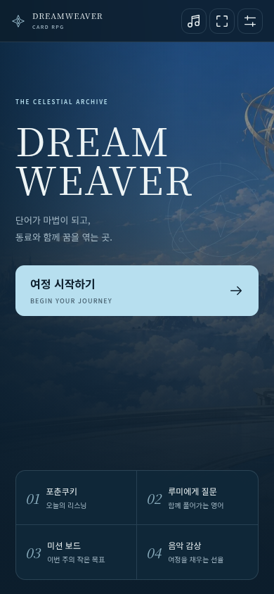
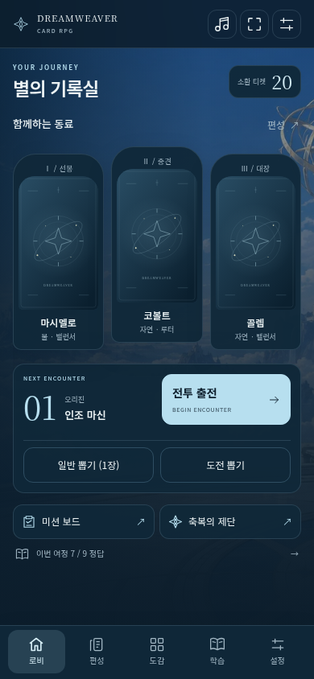
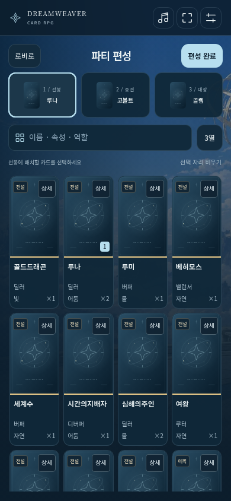
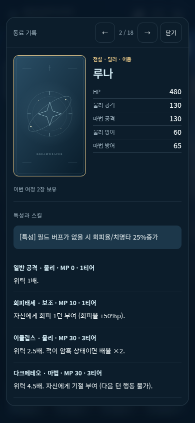
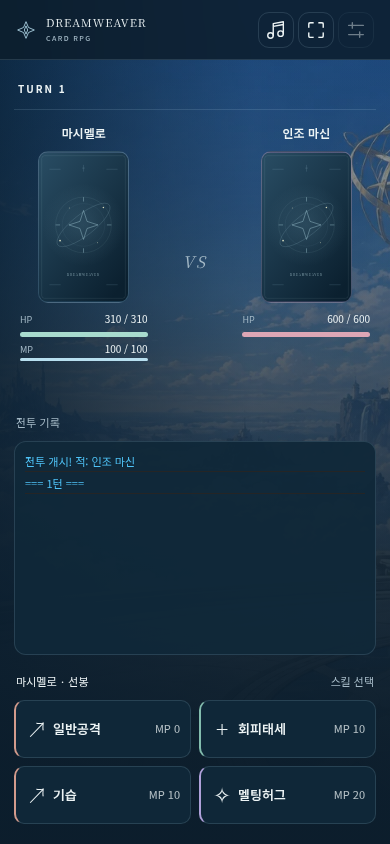
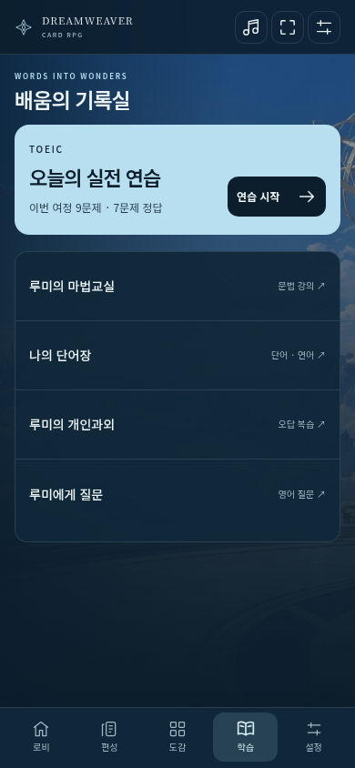

# Astra 화면 검토

기준 화면은 모바일 세로 390×844입니다. 아래는 실제 빌드를 Chromium에서 실행한 캡처입니다. 저장소에 개인 캐릭터 초상화가 없으므로 카드 뒷면이 표시됩니다. 로비·도감·전투에는 화면 비교를 위한 동일한 파티 상태를 사용했습니다.

| 타이틀 | 로비 |
| --- | --- |
|  |  |

| 편성 · 4열 | 카드 상세 |
| --- | --- |
|  |  |

| 전투 | 학습 |
| --- | --- |
|  |  |

## 확인한 범위

- 실제 시작 버튼에서 새 게임, 소환, 편성, 저장과 새로고침 후 이어가기.
- 편성 검색, 자리 비우기/배치, 기본 3열의 카드 6장 표시, 4열 전환.
- 상세 이동 시 고정 프레임, 게임 데이터와 능력치 일치, 파티 불변, Escape 후 포커스 복귀.
- 영구 해금 데이터, 도감 빈 검색 결과, 실제 문법 강의와 퀴즈 진행 수치.
- 전투 HP·MP 표시, 네 스킬의 화면 내 배치, 실제 일반공격으로 승리 처리.
- 360×640와 1440×960의 주요 행동 배치 및 가림 여부, 세 테마 전환 후 동일한 출전 버튼 좌표.
- 공용 DOM ID 보존, 중복 ID와 브라우저 예외 없음, 원격 UI 자원 요청 없음.

로컬 검증은 관리형 Chromium의 `file://` 제한 때문에 동일 배포 HTML을 로컬 HTTP로 제공했습니다. `file://` 부팅은 CI의 기본 테스트 경로로 남겨두었습니다. 실제 개인 초상화·음원, 모바일 실기기·소프트 키보드, 유료 AI 응답은 확인 범위에 포함하지 않습니다.

게임 규칙과 저장 파일 형식, 원본 `card/`와 `card_claude/`는 변경하지 않았습니다.
