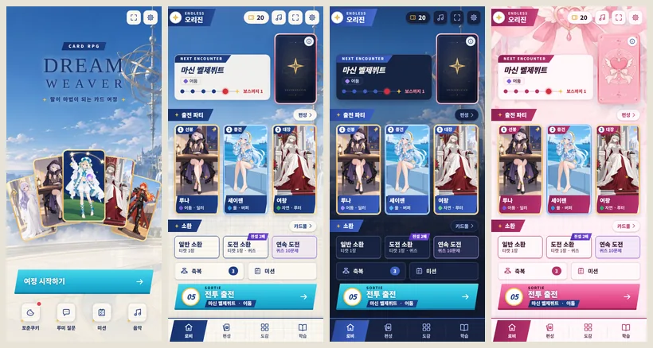
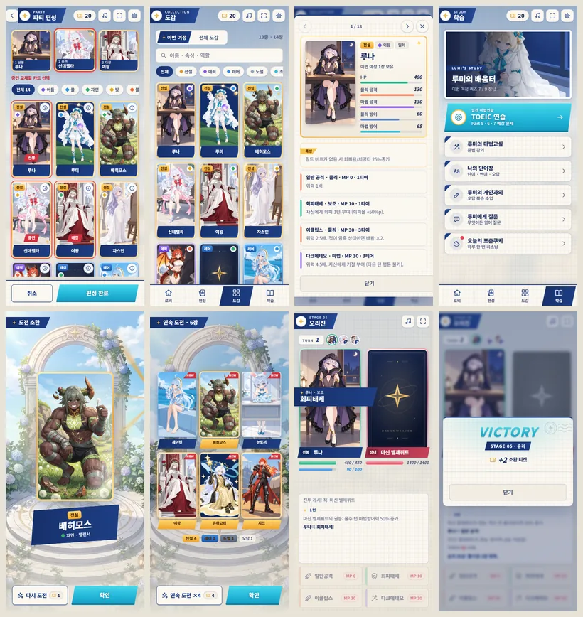

# DREAMWEAVER · Lumen

카드 게임의 화면과 조작 흐름을 상용 서브컬처 게임 수준으로 다시 짠 독립 UI 버전입니다. 별빛 정원(Defense) Bright 스킨의 "Postcard" 언어(코발트 네이비 구조 띠, 화면당 하나의 아쿠아 행동, 격자 종이, 등급 액자 카드)를 카드 게임에 맞게 재해석했습니다. 원본 `card/`, `card_astra/`, `card_claude/`는 그대로 둡니다.

**실행 파일: [dist/DREAMWEAVER-Lumen.html](dist/DREAMWEAVER-Lumen.html)** — 다운로드 후 브라우저에서 엽니다. 설계 의도와 메뉴별 판단은 [docs/DESIGN.md](docs/DESIGN.md)에 있습니다.



## 실행과 빌드

저장소 루트에서:

```sh
npm ci
npm run build:card-lumen
npm run serve --prefix card_lumen
```

미리보기 주소는 `http://127.0.0.1:4183`입니다. 배포 파일은 약 3.4 MiB의 단일 HTML입니다. 코드·학습 데이터·배경 그림·Noto Sans KR 서브셋을 포함하며 CDN이나 원격 글꼴이 필요하지 않습니다.

개인 캐릭터 PNG와 음악 MP3는 기존 파일명 그대로 HTML 옆에 놓습니다. 폴더가 다르면 설정 → 로컬 초상화에서 지정합니다. 그림이 없는 카드는 테마의 3:5 카드 뒷면으로 표시합니다. AI 질문·과외 등 외부 서비스 기능의 API 키와 네트워크 요구는 원본과 같습니다.

## 달라진 흐름

- **타이틀:** 저장이 없으면 "여정 시작하기" 하나만, 있으면 "여정 이어가기"(모드·스테이지 요약)와 "새로운 여정"을 보여줍니다. 포춘쿠키·질문·미션·음악은 아이콘 줄로 내리고 받을 보상이 있으면 점으로 알립니다.
- **로비:** 위에서부터 장면 → 출전 파티(3:5 카드) → 소환 → 준비(축복 횟수, 미션) → 출전 버튼 순서입니다. 출전 버튼에 다음 스테이지 번호, 상대 이름·속성, 보스·목표 스테이지를 함께 담아 한 번에 판단하게 했습니다. 상단 띠는 지금 여정의 종류와 모드를 보여줍니다.
- **소환:** 일반 소환은 1장 그대로입니다. 티켓이 2장 이상이면 **연속 도전**이 나타납니다. 도전 소환(티켓 1장 + 단어 퀴즈)을 최대 10번 이어서 풀고, 정답으로 얻은 카드를 마지막에 한꺼번에 공개합니다. 비용·확률·퀴즈는 원본 도전 소환 그대로이며, 진행 막대에서 언제든 그만둘 수 있습니다. 일반 소환의 연속 뽑기는 일부러 만들지 않았습니다(이유는 [DESIGN.md](docs/DESIGN.md#연속-도전)).
- **편성:** 하단 탭을 숨긴 집중 화면입니다. 들어오면 첫 빈자리가 선택되어 있고, 카드를 누를 때마다 다음 빈자리로 넘어갑니다. 배치된 카드에는 자리 이름이 붙고, 속성 칩으로 걸러 보며, 각 카드의 정보 버튼으로 상세를 엽니다.
- **도감:** 이번 여정 / 전체 도감 전환, 등급 칩, 이름·속성·역할 검색. 상세는 현재 목록 안에서 이전/다음으로 넘기며, 열람만으로 파티를 바꾸지 않습니다.
- **학습:** 루미의 서재 그림 아래에 TOEIC 연습을 주 행동으로 두고 강의·단어장·과외·질문·포춘쿠키를 목록으로 정리했습니다. 진행 수치는 이번 여정의 실제 퀴즈 기록입니다.
- **전투:** HP·MP를 즉시 갱신하고, 피해·치명타·회복·빗나감 숫자, 잔상 HP 바, 스킬·적 행동 배너, 파티 순번 표시를 더했습니다. 마지막 일격이 보인 뒤 결과창이 열리고, 결과창 머리에 보상을 요약합니다.
- **설정:** 흩어져 있던 게임 메뉴(저장, 기록, 카드풀, 과외 이벤트, 타이틀로)와 화면 테마, 기록 파일, 로컬 초상화를 한 창에 모았습니다. 헤더 톱니바퀴로 어디서든 엽니다.
- **테마:** 드림스카이(밝음, 기본) · 아스트라(밤) · 마법소녀(분홍). 색만 바뀌고 모양과 배치는 같습니다. Lumen의 테마 선택은 다른 버전과 따로 저장되어, 처음 열면 항상 밝은 테마입니다.

### 2차 개선

- **타이틀:** 비어 있던 가운데에 카드 다섯 장을 부채꼴로 펼친 키 비주얼을 넣었습니다. 저장이 있으면 그 여정의 파티와 높은 등급 카드, 없으면 루미를 앞에 둔 대표 캐스트입니다.
- **로비:** 남는 높이에 다음 상대의 3:5 카드, 속성·보스 표시, 주요 스킬, 6스테이지 순환 경로("보스까지 N")를 보여줍니다. 누르면 상대 스킬을 미리 봅니다. 화면이 낮으면 줄었다가 숨습니다.
- **전투**
  - 상태 배지를 카드 아랫단에 얹어 로그 칸을 넓혔고, 하단 여백을 늘렸습니다.
  - RPG 버전의 연출을 가져왔습니다.
    - 공격할 때 카드가 상대 쪽으로 돌진합니다.
    - 3단계 스킬과 상대의 대기술은 일러스트 컷인으로 보여줍니다. 누르면 건너뛰고, 설정에서 끌 수 있습니다.
    - 새로 걸린 버프·디버프는 ▲/▼ 칩으로 한 번 떠오르고, 배지는 카드에 그대로 남습니다.
    - 마신 벨제뷔트의 권능, 인조 마신의 방어 프로토콜처럼 턴마다 바뀌는 방어력도 배지로 표시합니다.
  - 마법소녀 테마의 스탯 창에서 흰색으로 보이던 수치를 테마 색으로 고쳤습니다.
- **소환**
  - 고등급 카드에는 은은한 빛줄기(에픽 이상)와 금별(전설 이상)이 지나갑니다. 소환 결과, 파티, 편성, 도감, 상세, 미션 보상에 같은 효과를 씁니다.
  - 도전 소환 버튼에 "전설 2배"처럼 실제 확률 차이를 표시합니다. 일반 소환 결과의 다음 버튼은 도전 소환입니다.
  - 연속 도전 결과는 이름을 카드 아랫단 리본에 한 줄로 넣고, 긴 이름만 글자를 줄이거나 두 줄로 씁니다.
- **모드 선택:** CLEAR·HARD CLEAR 표시를 이름 아래 줄로 옮겼습니다. 설명 칸 높이를 고정해 모드마다 창 높이가 바뀌지 않습니다.
- **편집 화면 통일:** 덱 편집·세트 편집·스페셜카드 편집을 편성 화면과 같은 구조로 바꿨습니다(앱 머리띠와 뒤로 버튼, 칩, 등급 액자 카드, 하단 고정 버튼).
  - 덱 편집은 한 줄 4장입니다. 카드를 누르면 추가/제외, 이름 리본을 누르면 상세입니다.
  - 세트 편집은 해금 진행 막대가 있는 목록입니다.
  - 스페셜카드 편집은 인물 칩 아래에 기본·스페셜 버전을 큰 카드로 나란히 놓고 고릅니다.
- **팩토리 드래프트:** 10라운드 진행 막대, 덱 장수, 묶음별 등급 집계, 4장짜리 카드 줄과 선택 버튼, 하단 고정 버튼으로 다시 짰습니다.
- **카오스 룰렛:** 초월 카드 뒷면 부채, 소환 가능한 초월 카드 목록, 티켓 수, 보관함 개수를 보여주는 제단 화면으로 바꿨습니다.
- **미션:** 허브와 각 미션 창이 보상(카드 그림 또는 티켓)을 앞세우고, 미션마다 진행 막대를 둡니다. 받을 수 있으면 버튼이 빛나고, 아니면 "미션 N개 남음"을 보여줍니다.
- **카드 상세:** 카드를 가운데에 크게 세우고 이름 띠와 스탯을 아래에 둡니다.
- **루미:** 강의·과외·데이트에서 루미를 잘리지 않은 3:5 카드로 제목 옆에 크게 세우고, 말풍선에 강의 순서와 읽는 시간을 보여줍니다.
- **번쩍임:** 상세 시트는 반투명으로 겹쳐 나타나지 않고 아래에서 밀려 올라옵니다. 대화창 뒤 흐림 효과도 없앴습니다. 루미 질문 창은 키보드가 올라와도 뒤 화면이 비치지 않는 불투명 화면으로 두고, 안쪽 패널만 보이는 높이에 맞춥니다.
- 화면과 대화창 하단의 버튼 아래 여백을 늘렸습니다.



미리보기의 초상화 자리에는 저장소의 별빛 정원 일러스트를 임시로 넣었습니다. 실제 게임은 플레이어의 개인 초상화 PNG를 씁니다.

## 소스와 호환성

| 경로 | 역할 |
| --- | --- |
| `src/shell.html` | 타이틀·로비·편성·도감·학습·전투와 카드 상세·설정 마크업 |
| `src/lumen.css` | Postcard 디자인 토큰, 세 테마, 기존 대화창 재도장 |
| `src/lumen.js` | 화면 렌더러, 소환·전투 연출, 연속 도전, 편성 자동 진행 |
| `build.mjs` | 공유 게임과 UI 지원 코드를 단일 HTML로 조립 |
| `assets/` | 압축 배경, 3:5 카드 뒷면, 글꼴과 라이선스 |
| `tools/prepare-assets.mjs` | 에셋을 한 번 압축·복사한 스크립트(빌드에 쓰지 않음) |
| `tests/smoke.mjs` | 실제 플레이 흐름 검증 |

규칙·보상·저장은 `card/game/`가 소스 오브 트루스입니다. 초상화 로딩, 기록 내보내기/가져오기, 중첩 대화창 포커스는 `card/src/astra.js`를 공유합니다. `lumen.js`는 공개 `RPG` 메서드 뒤에 연출을 덧붙이는 방식이라 원본의 모드·보상·밸런스를 다시 구현하지 않습니다. 원본 HTML의 모든 `id`가 그대로 남아 있는지는 테스트가 확인합니다. `card/src/`의 기본 CSS는 읽지 않고 레거시 CSS 위에 `lumen.css`를 직접 얹습니다.

저장 키는 다른 버전과 같지만 브라우저나 파일 경로가 다르면 저장 공간도 달라집니다. 기존 버전에서 **설정 → 기록 파일 → 내보내기**, Lumen에서 **가져오기**를 사용하세요. API 키는 내보내지 않습니다.

## 검증

```sh
npm run test:card-lumen
```

Playwright Chromium으로 `file://`에서 엽니다. 실행 환경이 로컬 파일이나 기본 브라우저 경로를 막으면:

```sh
LUMEN_TEST_HTTP=1 CHROMIUM_PATH=/usr/bin/chromium npm run test:card-lumen
```

신규 여정·소환·한 번에 배치·저장 복원, 편성 자동 진행과 상세 이동, 도감 범위·검색과 학습, 연속 도전(정답 2 · 오답 1 → 티켓 3장 소모, 카드 2장 공개), 전투 승리, 360×640·390×844·1440×960 배치, 세 테마의 출전 버튼 위치와 테마 저장을 확인합니다. 결과 스크린샷은 `test-results/`에 저장됩니다.

## 에셋 출처

- `observatory.webp`, `magical-sanctuary.webp`, `magical-card.webp`: 기존 `card/assets`의 PNG를 WebP로 압축했습니다. 원 출처는 [Card 디자인 문서](../card/DESIGN.md)와 [마법소녀 아트 기록](../card/assets/MAGICAL-ART.md)에 있습니다.
- `summon-altar.webp`, `lumi-study.webp`: 같은 세계관의 별빛 정원 에셋(`defense/assets/optimized/bright/summon-altar.webp`, `defense/assets/optimized/library/window.webp`)을 복사했습니다. 출처는 [defense/docs/ASSET_PROVENANCE.json](../defense/docs/ASSET_PROVENANCE.json)에 있습니다.
- `card-back-lumen.svg`: 이번 버전의 3:5 네이비·금색 카드 뒷면입니다.
- `dreamsans-subset.woff2`: Astra 버전과 같은 Noto Sans KR 가변 서브셋입니다. [SIL OFL 라이선스](assets/NotoSansKR-OFL.txt)를 함께 포함합니다.

새 그림을 생성하지 않았습니다. 그 밖의 장식(별, 소인, 리본, 격자)은 CSS와 인라인 SVG입니다.
