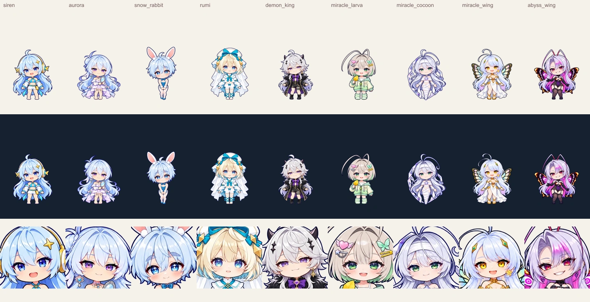
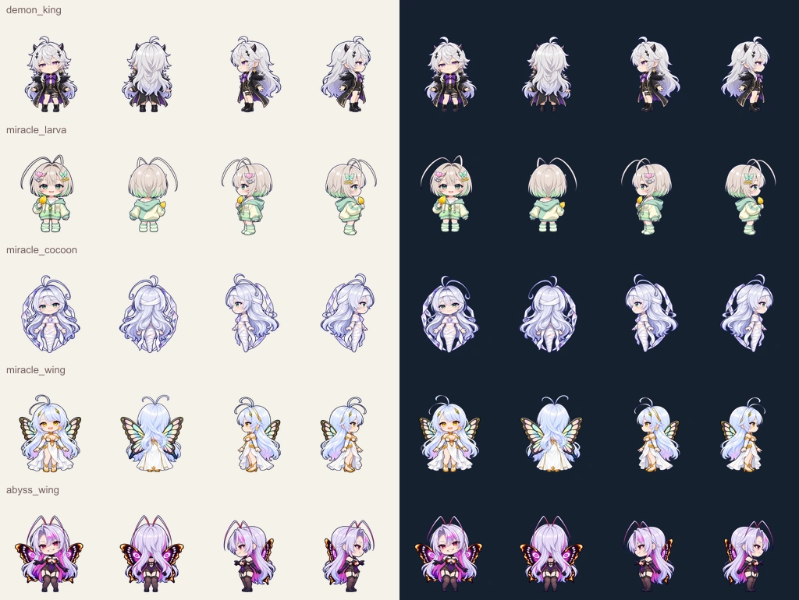
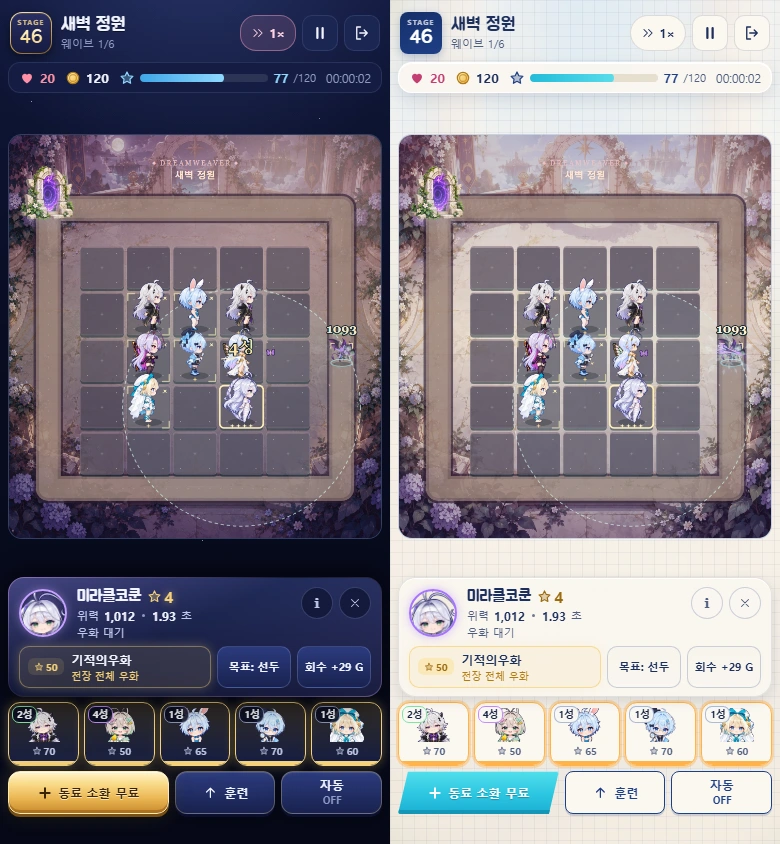
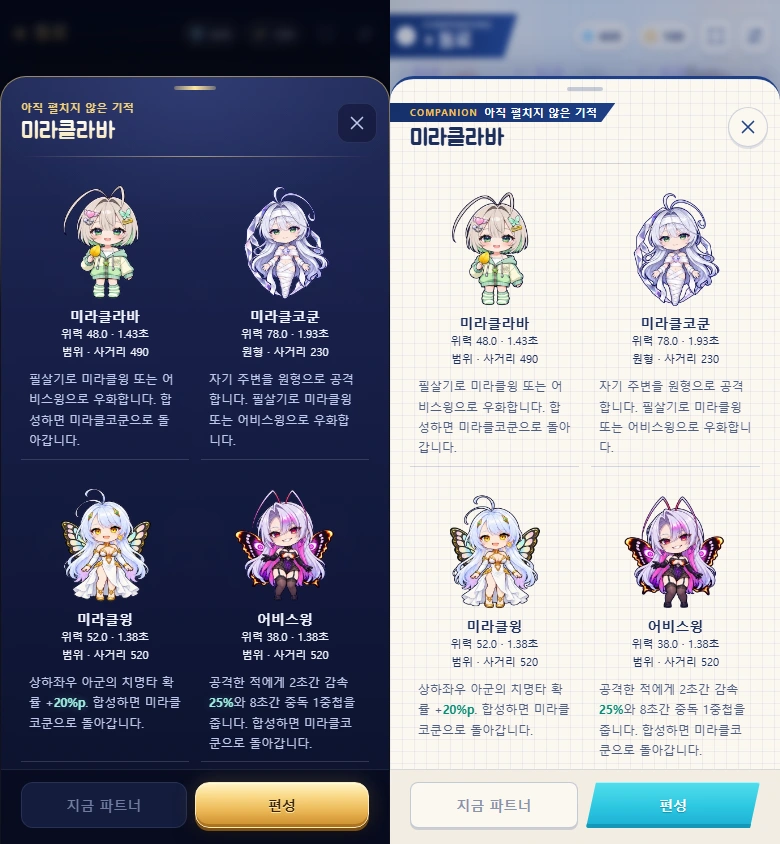

# 마왕과 미라클 계열 제작·검수 기록 (2026-10-25)

최종 사용본은 `assets/cast-v2/`의 마왕·라바·코쿤·미라클윙·어비스윙 5종이다. 미라클윙은 사용자가 제안한 **지팡이 없는 편안한 자세**를 채택했다. 전면의 장식·의상·금색 눈·나비 날개 정체성을 유지하고, 뒷치마는 닫으며 날개가 뒤에서 팔을 가리도록 했다. 지팡이 시안은 채택하지 않았다.

## 제작 입력과 방식

- 사용자 원화 5장은 `originals/`에 바이트를 보존했다. `inputs.json`에 생성 전 원화·동일 체형 구조 마스터·동결된 세이렌 화풍 참조의 역할, 해시, 프롬프트를 기록했다. 원화 얼굴을 눈·표정·머리 장식 등 관찰 가능한 특징으로 풀어 썼다.
- 마왕은 중성 보통 키, 라바는 중성 작은 키, 코쿤·두 윙은 여성형 보통 키로 정했다. 머리는 머리카락·뿔·더듬이·날개를 제외한 두개골/얼굴의 추정 타원이다. `landmarks.json`에 해부학 기준과 추정 오차를 남겼다. 코쿤의 다리는 원화처럼 하나로 감싼 형태다.
- `wing-structure.obj`와 `wing-unarmed-structure.obj`는 실제 3D 메시다. `scripts/art/miracle-structure.mjs`가 네 직교 카메라와 깊이 버퍼로 렌더링한다. 날개 뿌리는 상부 등, 손/팔은 몸 앞쪽이다. 무기 없는 가이드의 후면에서는 날개가 손/팔 632픽셀을 가리고 전면에서는 0픽셀을 가린다. 이것은 **구조 참조**의 측정이다.
- 최종 캐릭터는 구조 참조를 입력으로 그린 **2D 네 방향 이미지**다. 완성 캐릭터를 통째로 3D 모델링하거나 리깅한 결과라고 주장하지 않는다. 최종 후면의 가림 순서는 별도로 확대해서 확인했다.
- 메모리얼은 원화 중심 방향을 유지해 공급받은 마왕·라바 원화를 여백과 함께 720×1080으로 준비했다. 새 장면 일러스트를 생성하지 않았다. 메모리얼 짧은 이야기는 이번 구현에서 쓴 창작이며 원본 설정 인용이 아니다.

## 최종 선택과 보정

`final-selection.json`은 최종 조합과 해시를 기록한다. 미라클윙 정면·양옆은 `miracle_wing-natural-candidate.png`, 후면은 `miracle_wing-back-source.png`에서 선택했다. 후자는 팔이 날개 뒤로 가려지고 치마가 닫힌 후보다. 라바는 기울어진 초기 정면을 바로 세운 후보로 교체했다.

1254×1254 원본은 Sol Cast V2의 연결 성분 소유권 방식(`scripts/art/source-views.mjs`)으로 분리한다. **627픽셀 가로줄로 자르지 않는다.** 측면 더듬이가 행 경계 위로 올라간 픽셀도 원래 좌표 그대로 유지한다. 그 뒤 캐릭터 하나에 공통 등방 배율 하나만 적용하고 방향별 발 높이를 옮겨 1024×1024 아틀라스로 묶는다. 가로/세로를 따로 늘리거나 실루엣에 맞춰 체형을 줄이지 않는다. 20프레임 모두 발 기준 `[256,480]`, 불투명도 32 이상 채색 잘림 0이다. 자세·머리 아래 몸 길이·후면 두개골은 손으로 측정한 추정이므로 오차 범위를 함께 보관한다.

확인한 항목은 라바 정면의 기울기, 모든 형태의 머리 크기/발 높이, 코쿤의 감싼 하체, 미라클윙 뒷치마·등 날개·팔 가림, 어비스윙 측면 날개의 원근, 네 방향 외형과 좌우다. `check-facing.mjs`의 피부-머리 중심 차이도 신규 5종 모두 왼쪽 음수/오른쪽 양수다. 실제 전투 방향과 390×844 두 테마 캡처는 `test-results/demon-miracle/`에 남긴다.

[브라우저 측정 기록](browser-validation.json)은 두 테마의 우화/합성 2건과 다섯 외형의 실제 좌우 공격 10건이다. [전환 종료 후 재확인](theme-validation.json)도 오류·외부 요청·가로 넘침·이미지 실패가 없었다. 기존 윙이 유지되는지, 대상이 없을 때 차단하는지, 합성 후 코쿤 이름/초상화가 맞고 우화 버튼이 다시 열리는지 확인했다.

## 채택하지 않은 시안

`*-candidate-v*.png`, `staff-*`, `wing-3d-correction.json` 등은 제작 경위와 실패를 보존한 자료다. 런타임에서 참조하지 않는다. 원화 지팡이가 기울어 보인다는 이유로 보석을 평평한 사각형으로 재해석한 초기 프롬프트는 잘못된 판단이었다. `staff-master-rejected-square.png` 및 그 프롬프트는 **명시적으로 기각**했다. 보석의 다이아몬드 꼭짓점·금장 형태를 보존하는 재시도도 후면 가림과 직선 축의 일관성까지 만족하지 못했다. 디자인이 달라진 지팡이를 통과시키지 않고, 사용자 허용에 따라 최종 지팡이를 생략했다.

재실행: 구조 `node defense/scripts/art/miracle-structure.mjs --unarmed`, 패킹 `node defense/scripts/art/pack-demon-miracle.mjs`, 같은 크기 검수 `node defense/scripts/art/review-demon-miracle.mjs`. 일반 빌드는 생성/패킹/압축을 하지 않고 준비된 결과와 해시를 검사해 읽는다.
