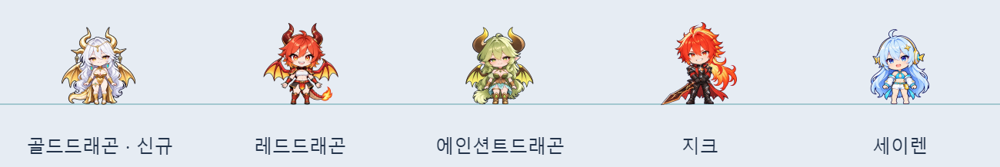
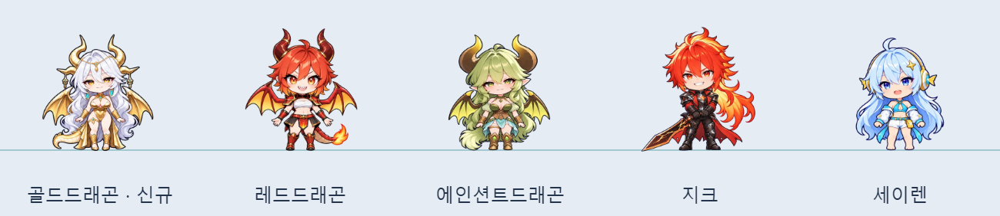
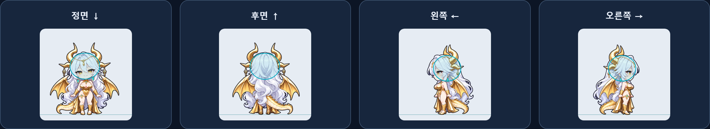
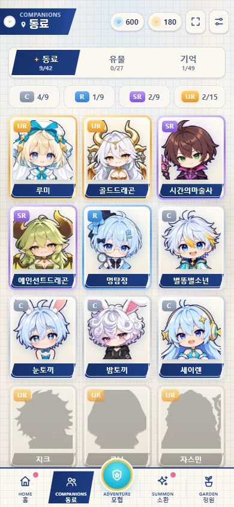
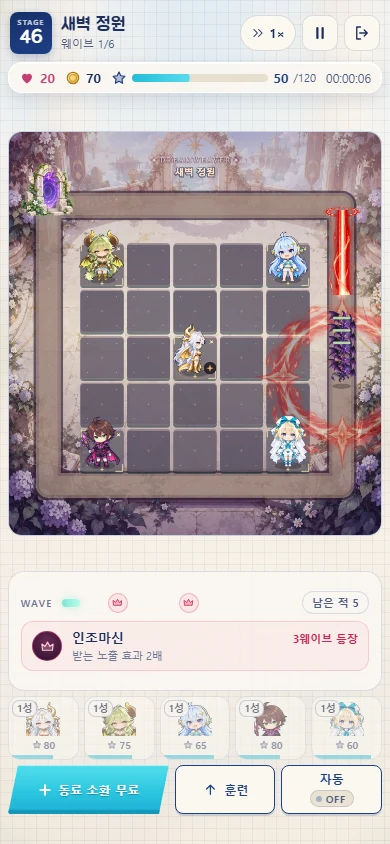
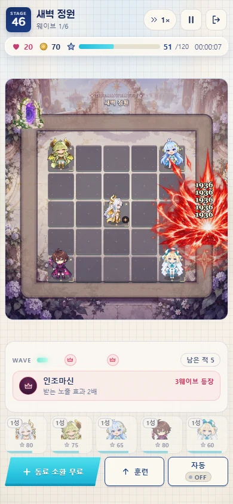

# 골드드래곤 · 원본·제작·검수 기록

10월28일 작성해 검토한4방향 SD를10월29일 사용자 요청으로 설치한다. 의상·장식·헤어를 새로 해석하거나 SD를 다시 생성하지 않았다. 수치와 차지 규칙은 [구현 기록](../../archive/2026-10-29-GOLD_DRAGON.md), 현재 상수는 [자동 수치표](../../CURRENT_VALUES.md)를 본다.

## 입력과 보존

- sd/generation.png와 generation-v1.png: 내장 이미지 생성 도구의 native-alpha 원본과 이전 후보.
- sd/inputs.json, 각 프롬프트, selection.json: 실제 입력 역할·해시와 수정·선택 이유. 당시의 “미설치” 패킹 기록은 소급 수정하지 않는다.
- sd/gold_dragon.png: 선택한 손실 없는1024×1024 패킹. 게임 보관본은 assets/cast-v2/gold_dragon.webp.
- installation.json: 설치 PNG/WebP 경로·해시와 방향별 기준점. 보관 WebP SHA-256은 e7083366c6abc9e35d789625415e212380e98b231293fadfd03f7768acb3ba52.
- 구조 입력은 여성형·큰 키 가이드, 화풍은 동결된 세이렌, 정체성은 제공된 원화다. 승인된 에인션트 드래곤을 용족 장식·재질 비교로 함께 사용했다.
- 제공 원화는 assets/memorial-sources/gold_dragon/8644f560115f835e6b5c5d7700b5b0cc81cd3a6a9953c61490e33579ffa721d3.png에 보존한다.
- vfx/generation.png, prompt.txt, packing.json: 필살기6요소의 생성 원본·프롬프트·20px 셀 여백·출력 해시. 배경 키잉 없이 native alpha를 사용한다.
- 일반 공격은 이미지 없이 그린다: 네 갈래 빔(따뜻한 금색 몸통 + 가는 밝은 심), 빔 머리를 따라 흩어지는 별가루, 적중 지점의 작은 별 반짝임. 처음 설치한 ancient-cross.webp 중앙 도장은 캐릭터 뒤에 깔려 네 끝만 몸 밖으로 삐져나와 2026-10-29에 뺐다(에인션트 드래곤도 함께). 그 이미지는 에인션트 드래곤의 적중 표시로만 남는다.

## 비율·방향

공통 전신 배율0.692958928675237, 네 방향 발(256,480)이다. 방향별 별도 배율과 가로·세로 왜곡이 없다. 정면 두개골 타원 중심(250.46,209.05), 크기164.92×145.52, 기울기−3°다. 턱 아래 길이는 정면199.57·후면197.49·좌190.56·우191.26이다. 뿔·머리 부피·귀걸이·날개·꼬리를 머리나 키에 넣지 않는다.

금색 뿔과 날개가 기존 방향 검사의 피부색 임계값에도 걸렸다. check-facing.mjs는 이 개체의 기록된 머리 타원 안에서 뿔 아래 볼을 측정한다. 좌−13.30·우+17.71이다. 좌우 셀을 가상으로 바꾸면+9.16/−10.62로 실패하므로 통과 예외 명단에 넣은 방식이 아니다. 실루엣 반전 유사성도 별도 검사한다.

좌우 장식과 꼬리는 해부학적 부착 방향을 보존한다. 네 방향은 하나의3D 리그를 회전시킨 결과가 아니다. 수동 추정 불확실성은 원본 정면·측면±18px, 후면±26px, 발±5px다. 이는 통계적 신뢰구간이 아니다. 면적 정규화 자체를 독립적인 일관성 증명이라고 부르지 않는다.

## 배포 가공

prepare.mjs는 제공 원화를 보존해 메모리얼을 만들고 선택한 필살기를6칸으로 가공한다. 원본은 content-addressed 경로에 보관하고 다른 그림을 덮어쓰지 않는다. 일반 빌드에서는 이미지를 인코딩하지 않는다.

prepare-pack.mjs는 새 동료·필살기·메모리얼4개 입력만 기존 압축 팩에 추가한다. optimize-images.mjs --derived-only로 새 초상화·전신·앨범 썸네일3개를 만들고 기존156개 파생본을 재사용했다. 호환판의100KiB 제한을 맞춘 WebP에서 앨범 썸네일1개를 다시 준비하고 나머지158개를 재사용했다.

| 입력 | 보관본 | 배포본 |
|---|---:|---:|
| SD4방향 | 244,274B | 90,054B · 640×640 |
| 필살기6요소 | 672,218B | 509,144B · 1536×1024 |
| 메모리얼 AVIF | 58,403B | 45,855B · 720×1080 |
| 메모리얼 WebP fallback | 99,294B | 96,712B · 720×1080 |

최초 q82 WebP 후보(121,890B)는 원본 보존 경로에 남기고,100KiB 미만인 q76 WebP(99,294B)를 호환판 채택본으로 등록했다. 배포 팩은 이 채택본만 참조한다.

용량 감소와 브라우저 검증은 실제 휴대폰의 FPS나 사용자 최종 화질 승인을 의미하지 않는다. WebP fallback은 웹/호환 배포용이며 기본 통합 HTML에는 메모리얼 AVIF 한 코덱만 내장한다.

## 비교 도구

~~~powershell
node defense/docs/art/gold-dragon-20261029/build-review.mjs <출력 HTML 절대경로>
node defense/docs/art/gold-dragon-20261029/verify-review.mjs <출력 HTML 절대경로>
~~~

실제 엔진·렌더러를 묶고 시간 탐색·프레임 이동·0.25/0.5/1배 재생·다수 배치·새벽 배경을 제공한다. 일반 공격의 붉은 그림이 원래 이미지 객체인지, 금색 변환에서 알파가 바뀐 픽셀이0개인지 검사한다. 모바일390×844와 필살기 단계별 캡처는 defense/test-results/gold-dragon/에 둔다.

최종 게임 화면 검수는 같은 폴더의 JSON과 PR에 기록한다. 정지 표적 비교와 자연 진행, Chromium 자동화와 실제 기기 성능을 구분한다.

## 이번 검증 결과

[검증 요약과 배포 파일 해시](verification.json), [실제 통합 HTML 검수](evidence/browser-verification.json), [실제 렌더러 비교 검수](evidence/review-verification.json)를 보관한다.

- 디펜스 전용 최소 선택 검증238개 통과. 이 중 골드드래곤 회귀는17개다.
- 일반판·Bright 통합 HTML을 file:// 오프라인 Chromium390×844에서 확인했다. 홈·동료 목록·정보·메모리얼·이야기·좌우 전장·차지·저장/이어하기·착탄을 실제 UI로 검사했다.
- 두 테마20캡처에서 가로 넘침과 누락 이미지가 없었고 외부 네트워크 요청0·JS 오류0이었다.
- (처음 설치 당시) 일반 공격 금색 변환의 알파 변경0픽셀, 붉은 공격은 원래 이미지 객체 재사용이었다. 같은 날 중앙 십자를 빼고 빔·별가루로 바꾼 뒤 실제 렌더러 비교 검수(normal-comparison.webp, review-verification.json)를 다시 찍었다.
- 비교 도구에서6초 시전→11초 발사968,4.9초 시전→9.9초 발사1,936이 이후10초를 넘겨도 비행 중 유지되는 것을 확인했다.
- 원화와 SD 보관본은 수정하지 않았다. 가려진 머리 경계는 수동 추정이며 실제 기기의 FPS·터치 감각은 이 자동화로 측정하지 않았다.

