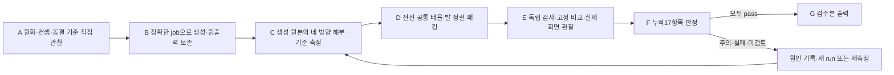

# Star Garden SD · 정식 A–G 제작 공정

2026-11-08 게임 저장소로 승격했다. 세션의 기억이나 개인 작업 폴더를 실행 의존성으로 사용하지 않는다. 진입점은 저장소의 `.agents/skills/star-garden-sd-art/SKILL.md`, 실행기는 `defense/scripts/art/sd-pipeline/pipeline.mjs`, 누적 규칙은 같은 폴더의 `policy.mjs`다. [시각 도구](index.html)에서9종 마네킹·동결 화풍·실제 실행 프롬프트·이번 선택본을 볼 수 있다.

## 순서와 완료 조건



| 단계 | 실제 할 일 | 완료 조건 |
|---|---|---|
| A | 원화/컨셉, 같은 체형 동료, 동결 화풍/구조를 직접 본다 | 모든 참조의 관찰·해시와 정확한 job |
| B | 고정 job으로 내장 이미지 도구를 실제 호출하고 원파일을 수집한다 | 실제 출력 식별자·원본/참조/job/정책 해시 |
| C | 변형하지 않은512px 셀 좌표의 두개골·눈·턱·어깨·골반·발·윤곽 표본 | 네 방향, 측정자·불확실성·원본 해시 |
| D | 한 캐릭터의 전신 등방 배율 하나, 뷰별 평행 이동, PNG/WebP/초상화 | 알파32 잘림0, 방향별 배율 없음, 보이는 무손실 픽셀 변화0 |
| E | 독립 imgutils/ONNX와 LPIPS/SSIM/CCIP, 실제 고정 검수책 | 현재 파일/코드/전체 Python 환경/기준 분포 지문, 실제 캡처 |
| F | 사람이 현재 검수책의 모든 화면을 직접 보고 전체 항목 판정 |17개 전부 존재, 판정/화면/이미지/정책의 현재 해시 |
| G | 검수본 복사·매니페스트 | 모든 항목 pass, 모든 의존성 현재 상태 |

이것은 완성 캐릭터를3D 리그에 묶는 기능이나 자동 미학 판정기가 아니다. 마네킹은 생성의 구조 참고다. 숨은 두개골·관절은 수동 추정이고, 정상화된 숫자·검출 박스·픽셀 보존·브라우저 테스트는 실제 시각 판정을 대신하지 않는다.

## 한 번 설치

Node 의존성은 저장소의 `npm ci`를 사용한다. Python3.12와 CPU 독립 검사는 아래 명령으로 준비한다. venv는 Git에서 제외된 `defense/test-results/sd-pipeline/runtime/.venv`에 만든다. 첫 설치/모델 준비에는 인터넷이 필요하며 이후 실제 측정은 캐시된 모델로 오프라인 실행한다. 유료 이미지 API를 호출하지 않는다.

```sh
npm run setup:defense:sd-pipeline -- --warm-models
npm run doctor:defense:sd-pipeline -- --audit
npm run test:defense:sd-pipeline
```

Windows 기본은 `py -3.12`, 다른 OS는 `python3`다. 다른 Python3.12 실행 파일이 필요하면 `DEFENSE_ART_SETUP_PYTHON`만 지정한다.64개 버전 고정은 `requirements.lock.txt`, 직접 의존성은 `requirements.txt`다. 모델 가중치는 imgutils/Hugging Face의 사용자 캐시에 있으며 저장소에 커밋하지 않는다. 모델을 아직 받지 않았으면 E가 실패해야 하며 합격으로 건너뛰지 않는다.

선택적 환경 변수는 `DEFENSE_ART_PYTHON`, `DEFENSE_ART_CHECKER`, `DEFENSE_ART_REFERENCE_REPORT`, `DEFENSE_ART_AUDIT_CACHE`다. 기본값은 모두 이 저장소/작업 폴더에서 계산한다. 동결된40종 분포는 `reference-cast.json`에 있으며2026-11-07 자료다. 최신 전체 캐스트 검사라고 표현하지 않는다. 외부/추가 검사를 채택할 때 정책과 의존성/출처를 명시적으로 버전 관리한다.

## 새 제작 시작

원화와 설정을 먼저 보고 `design.txt`에 표정/눈/의상/재질/실루엣, `equipment.txt`에 실제 좌우 손·장비·가림 관계를 작성한다. 체형/키9개 중 적절한 것을 고르고 비교 동료3명 이상을 선택한다. 다음은 사용법 예시이며 생성이나 관찰이 실행된 기록이 아니다.

```sh
npm run sd:brief:defense -- --id siren --original "/path/to/original.png" --design "/path/to/design.txt" --equipment "/path/to/equipment.txt" --frame feminine-medium --peers jasmine,queen,cinderella --out defense/test-results/sd-pipeline/siren/brief.json
npm run sd:defense -- create defense/test-results/sd-pipeline/siren/run defense/test-results/sd-pipeline/siren/brief.json
npm run sd:defense -- status defense/test-results/sd-pipeline/siren/run
npm run sd:defense -- next defense/test-results/sd-pipeline/siren/run
```

`sd:brief:defense`는 원본 구조 마스터 전체의 밝은 배경 참조, 동결 화풍의 정면512px 크롭과 기존 정면의 고정 얼굴창을 준비한다. 확대하지 않은 역할별 참조로, canonical 원화·화풍·구조·동료와 함께 A의 해시에 연결된다. 정확한 생성 입력 순서는 job에 기록된다. 이전 화풍 아틀라스의 작은 측면을 구조 크기 기준으로 복사하지 않는다.

`brief.generationReferences`로 순서/역할을 명시할 수 있고 `brief.generationPrompt`로 짧은 정밀 수정 프롬프트를 고정할 수 있다. 이것은 A 전에 결정한다. job을 바꾼 뒤 옛 A 승인을 유지하지 않는다. 프롬프트를 바꿔도17개 후속 검수는 사라지지 않는다. 원본 디자인·성별 체형·키군을 지시자가 분석하는 작업 자체를 없앤 기능이 아니다.

## 실행 명령과 기록

```sh
npm run sd:defense -- inspect-inputs <run> <실제로-본-입력관찰.json>
# job의 실제 prompt/referencePaths로 내장 이미지 도구를 호출한다. CLI가 호출하지 않는다.
npm run sd:defense -- ingest <run> <실제-도구출력.png> <generation.json>
npm run sd:defense -- measure <run> <anatomy.json>
npm run sd:defense -- pack <run>
npm run sd:defense -- audit <run>
npm run sd:defense -- review <run>
npm run sd:defense -- decisions-template <run>
# 검수책을 실제로 본 뒤 양식을 채운다. 양식 생성은 판정이 아니다.
npm run sd:defense -- decide <run> <decision.json>
npm run sd:defense -- export <run>
```

A의 JSON은 `reviewer`, `policySha256`, `inputHashes`(모든 `referenceKeys`), 각 역할의 실제 `observations`를 갖는다. B는 `tool:"image_gen"`, 실제 `toolOutput`/절대 `toolOutputPath`, `rawSha256`, `jobSha256`, `policySha256`, job 순서 그대로의 `referenceHashes`, `method`, `historical:false`를 기록한다. 현재 B는 내장 도구의 투명 정사각 원출력 경로를 지원하며 다른 이미지 공급자의 어댑터를 구현했다고 주장하지 않는다.

C는 `coordinateSpace:"unwarped-512-cell"`, `rawSha256`, `measuredBy`, `uncertainty`, `exclusions:"hair-hats-ears-horns-ornaments-equipment"`와4개 `views`다. 각 뷰의 `skullEllipse:[cx,cy,w,h,angle]`, `chin`, `shoulders`, `hips`, `sole`, 보이는 눈 `eyeLeft/eyeRight`를 기록한다. 정면의 `outerSleeve`, `outerFoot`도 실제 선 표본 위치에 둔다. 턱·발·관절이 아닌 헤어/코트 끝을 표시하지 않는다.

부분 수정은 **새 run**과 고정 `brief.edit`의 `baseFile`, `maskFile`, `protectedRects`, 구체적 `reason`을 사용한다. `compose <new-run> <native-candidate>`로 합성/proof를 만들고 B에 `method:"protected-regional-edit"`와 `compositeProof`를 넣는다. 코드가 원본·후보·마스크로 결과를 재현하고 보호 영역 변경0을 검사한다. 캔버스 해상도가 다르면 `allowIsotropicCanvasResample:true`를 명시해야 정사각 전체 배율만 바꿀 수 있다. 이음새가 나쁘면 탈락이며, 일체형 그림을 선택할 경우 새 run에서 머리/몸/화풍 판정을 모두 다시 한다.

F는 `decisions-template`의 binding을 유지하고17개 각각의 상태/근거/증거 그룹/실제로 본 캡처 해시를 채운다. 머리는 `method:"fixed-scale-visual-plus-landmarks"`와 독립 검출의 경고 해석이 필요하다. 과거 이미지를 `mode:audit`로 가져온 실행은 당시 생성 전 승인으로 소급 인증되지 않고 G도 통과할 수 없다.

## 누적 필수17항목

실행 기준은 `policy.mjs`다. **원화 보존 / 동결 화풍 / 실제 머리 / 얼굴·표정 / 네 방향 정합 / 머리 대비 몸·몸통·다리 / 장비 좌우·가림 / 체감 부피 / 외곽선 / 명암·재질 / 캐스트 전체 인상 /64·96px 양 바닥 / 초상화 중앙 / 연결부·접촉 / 독립 검사 실행 / 출처 / 전처리 보존**을 모두 유지한다. 시각 도구와 검수책은 현재 정책에서 목록을 읽는다. 새 요구는 항목과 정책 스냅샷으로 누적하며, 다음 변경에서 기존/추가 항목을 제거하면 상태 검사부터 실패한다.

머리는 두개골/얼굴이고 귀·헤어 부피·모자·뿔·후광·무기와 장식은 제외한다. 목표는 정면160×150/측면깊이144, 바닥(256,480), 턱 아래176/188/200이다. 한 캐릭터의 전신 배율은 하나다. 머리만/다리만/가로세로 따로 늘리거나 장비 외곽에 맞추지 않는다. 고개 기울기는 회전 타원과 실제 눈~턱·볼을 함께 본다. 숫자가 목표여도 같은 배율 동료 옆에서 작은/큰 얼굴로 보이면 다시 판단한다.

현재 화풍의 가는 유색 외곽 약1.5~2.5px/512셀과 더 가는 내부선, 선택적 셀 명암을 기준으로 한다. `ASSET_PIPELINE.md` 아래에 남은 옛 후보용4px 보강 규칙을 현재 승인본에 자동 적용하지 않는다. 검은 옷 그림자/속눈썹을 외곽선으로 오인하지 않는다. 자연스러운 서기와 미세한 표정/각도 개성을 유지한다.

## 변경하면 다시 여는 것

원화/화풍/구조/정책 변경은 A 이후 전체, 새 그림은 B 이후 전체, 기준점 수정은 C 이후 전체, 최종 아틀라스/크롭/WebP 변경은 D 이후 전체, 검수 화면 변경은 E 이후 전체를 무효화한다. 실행 코드 지문이 바뀌어도 기존 영수증은 다시 검증해야 한다. 현재는 보수적인 전체 최종 재검수이며, 검수별 부분 재사용을 구현한 것처럼 말하지 않는다. 동일 입력의 유효한 기록에는 새 이미지 호출을 반복하지 않는다.

## 게임 적용은 별도

G는 검수본 출력이며 게임/PR 적용 허가가 아니다. 반대로 사용자가 공개된 주의 후보를 명시적으로 선택하면 그 선택을 따로 설치 기록에 남길 수 있다. 경고 판정을 pass로 고치거나 G 성공으로 위장하지 않는다. 이번 [선택 기록](../selected-cast-20261108/README.md)의 체리프린스가 그 사례다.

원본 PNG/무손실 WebP·생성 전 원출력을 보존하고, `ASSET_PATHS`/해부 기준과 `portrait-layout.js`의 작은 UI 보정을 나눈다. 최적화는 보관본에서 정해진 배포 경로로 만들고 원본/출력/크롭 해시를 함께 갱신한다. 일반/Bright/랩을 한 번 빌드하고390×844의 실제 사용처·적의 좌우 방향을 확인한다. 모델 생성/임의 재생성/전역 스킬 설정 변경/다른 게임 변경/PR 발행을 이 공정의 묵시적 권한으로 확대하지 않는다.
