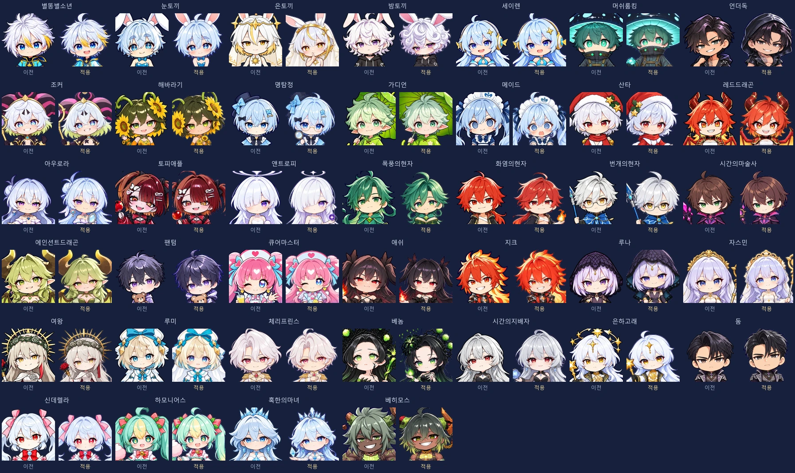

# Sol Cast V2 통합 검수

이번 검수는 정식 `defense/dist/StarGardenDefense.html`과 `StarGardenDefenseBright.html`에 들어간 실제 이미지와 계산을 확인한다. 원 제작 비교 기준 `fa6fcff`와 게임 통합 기준 main `19e2121`을 구별한다.

## 실행 결과

- `npm run verify -- --only defense`: 관련 빌드·에셋·저장/전투·배포 검사 **122개 통과**. 전투 회귀 114개에는 이번에 추가한 성장·만료·반경 경계 사례 6개가 포함된다.
- `node defense/scripts/generated-reports.mjs --check`: 현재 수치·원본 provenance·밸런스 보고서 일치.
- `node defense/scripts/art/check-facing.mjs`: 게임의 현재 ASSET_PATHS를 따라 40종을 검사한다. 예전 보관 폴더를 검사하고 새 에셋 검증이라고 보고하지 않는다. 방향 오탐 제외 목록은 추가하지 않았다. 피부색 중심/실루엣 검사는 휴리스틱이며 아래 실제 네 방향 배치도 함께 본다.
- Chromium, **390×844 / DPR 2**, `file://`와 네트워크 차단: **36개 장면·402개 확인 항목**, 페이지 오류 **0**, 외부 HTTP 요청 **0**. [구체적 장면·내장 해시 확인 결과](verification.json).
- 일반·Bright 각각 전투 아틀라스 **40개**, 초상화/전신 UI 이미지 **78개**의 내장 바이트를 `ASSET_OPTIMIZATION.json` SHA-256과 대조했다. PNG/WebP 설치본 80개도 승인 아카이브의 해시와 일치한다.

검수 실행: `node defense/scripts/review-cast.mjs`. `--section=art`, `--section=stats`, `--section=attacks`로 필요한 부분만 실행할 수 있다. Chromium 경로가 별도라면 `PLAYWRIGHT_BROWSERS_PATH`를 설정한다. 출력 PNG와 상세 원자료는 고정 `defense/test-results/cast-v2/`에 남으며, 여기에는 선택한 검수 화면을 별도 WebP로 보관한다.

## 실제 배치

한 행에 같은 캐릭터의 ↓ ↑ ← →를 놓은 유효한 저장 fixture를 실제 게임에서 이어한다. 5명씩 20개 유닛을 그리는 화면 8세트로 동료 39명을 확인하고, 별도 트라우마 활성 상태로 변신의 네 방향을 확인한다. 자동 전투는 끄고 같은 시점에 일시정지했다. 일반·Bright 양쪽에서 같은 검사를 했다. 이 고정 배치는 그림을 비교하기 위한 것이며 실제 플레이의 재미나 전투 성능 측정은 아니다.

| 일반판 네 방향 | 내용 |
|---|---|
| [1번](night-field-1.webp) | 별똥별소년·눈토끼·은토끼·밤토끼·세이렌 |
| [2번](night-field-2.webp) | 머쉬룸킹·언더독·조커·해바라기·명탐정 |
| [3번](night-field-3.webp) | 가디언·메이드·산타·레드드래곤·아우로라 |
| [4번](night-field-4.webp) | 토피애플·앤트로피·폭풍의현자·화염의현자·번개의현자 |
| [5번](night-field-5.webp) | 시간의마술사·에인션트드래곤·팬텀·큐어마스터·애쉬 |
| [6번](night-field-6.webp) | 지크·루나·자스민·여왕·루미 |
| [7번](night-field-7.webp) | 체리프린스·베놈·시간의지배자·은하고래·둠 |
| [8번](night-field-8.webp) | 신데렐라·하모니어스·혹한의마녀·베히모스 + 편성 채움용 소년 |
| [트라우마](night-trauma.webp) | 변신 4방향과 현재 버프 표시 |

[Bright 지크·루나 세트](bright-field-6.webp), [Bright 마녀·베히모스 세트](bright-field-8.webp), [실제 왼쪽 적 공격](attack-left.webp), [실제 오른쪽 적 공격](attack-right.webp), [홈 전신](night-home.webp)도 확인했다. 얼굴·성급·현재 전투 정보가 가려지지 않는지 눈으로 검토했다.

## 초상화 비교

각 이름 아래 왼쪽은 이전, 오른쪽은 적용본이다. 이전 파일은 동결 원본 해시와 **그 파일의 과거 portrait 좌표**를 사용하고, 적용본은 실제 배포 UI 파일을 사용한다. 양쪽을 같은 크기로 표시했다. 신규 두개골 좌표를 과거 그림에 재사용하거나 귀·모자까지 두개골로 재평가하지 않았다.

검토한 특이점: 가디언의 후면은 실제 우산 바깥면이 뒤통수를 가린다. 큐어마스터 모자·머쉬룸킹 모자·토끼 귀는 머리 측정에 포함되지 않는다. 은하고래의 원화 배경 고래를 새 머리 장식으로 붙이지 않았다. 좌우는 실제 시점으로 그린 별도 이미지이며 일괄 반전으로 비대칭 장비를 바꾸지 않았다.

## 현재 수치 화면

조건은 3성·훈련 3회·강화 10이다. 실제 버튼으로 선택하고 정보창을 열었다.

- [눈토끼](night-stats-snow_rabbit.webp): 일반 감속 **66.2%**, 필살기 빙결 **2.9초**, 감속 **72%**.
- [폭풍의현자](night-stats-storm_sage.webp): 즉사 **1.4%**.
- [번개의현자](night-stats-lightning_sage.webp): 연결 4기 위력 **+60%**, 체인 **80%**, 추가 대상 **+1**.
- [혹한의마녀](night-stats-frost_witch.webp): 필살기 감속 **72%**, 감속과 겨울 모두 표시 **8.6초**(실제 8.64초), 후속 빙결 **0.8초**.
- [베히모스](night-stats-behemoth.webp): 훈련 반경 **129.375**, **0.5초 간격 × 3회**.
- [애쉬](night-stats-ash.webp): 현재 피해 계산에 **18배** 반영.
- [훈련 메뉴](bright-training.webp): 눈토끼·마녀는 전장의 실제 성급과 강화를 포함한 역할 수치, 베히모스는 훈련한 실제 필살기 반경 표시.

수치 자체는 화면 반올림과 구별한다. 시간/감속 표시는 한 자리까지 반올림하고 내부 만료시각·판정값은 유지한다. 자동 회귀는 필살기 직후 눈토끼의 공격, 6초 이후 마녀의 계속된 공격, 성장한 겨울의 동시 만료, 실제 즉사 난수의 경계, 충격 반경 안/밖과 시전 후 훈련·저장 복원을 확인했다.

## 용량·보존·남는 한계

최종 보관 WebP 40장 **8,477,396 B**, 실제 640px 전투용 WebP 40장 **3,163,282 B**. 압축 전후를 별도 보관하며 최종 PNG 40장도 Git에 보존한다. 정식 단일 HTML은 일반 약 **17.83 MiB**, Bright 약 **17.90 MiB**이며 최신 바이트는 [검수 JSON](verification.json)의 release 필드를 따른다.

전체 제작 아카이브에는 원화·프롬프트·3D 가이드·후보·64/96px 전후 비교와 수작업 측정의 불확실성이 남아 있다. 가려진 머리의 정확한 크기를 증명한 것이 아니며, 실제 캐릭터 3D 모델을 회전시킨 결과도 아니다. 일부 주름·머리 가닥·마법 소품의 방향별 세부 차이는 남는다. 실제 Android/iOS의 FPS·발열·배터리·장시간 안정성이나 주관적인 재미의 우열은 이 검수로 인증하지 않는다.
