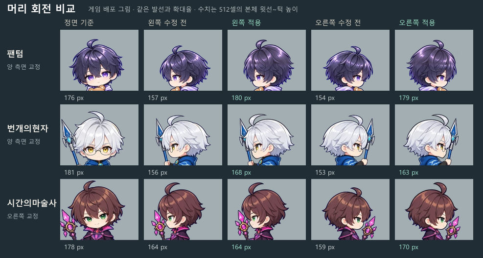
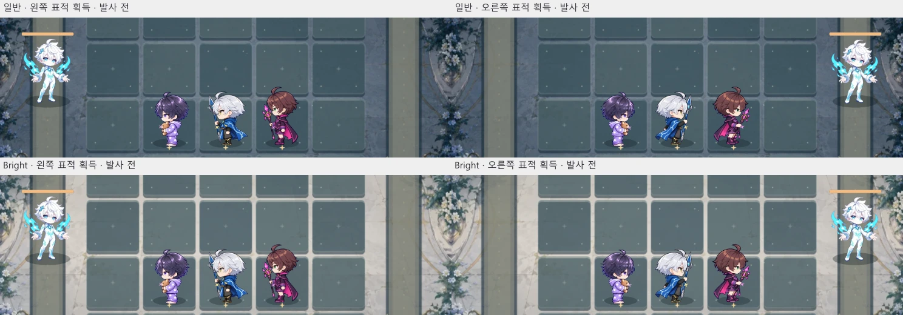

# SD 측면 교정 · 2026-11-20

팬텀·번개의현자의 양 측면과 시간의마술사의 오른쪽을 교정했다. 기준은 main `3379bc5e9a5edf40d87a00e3be8ca207ca866185`의 일반판·Bright판에 실제로 내장된 그림이다. 정면과 후면은 세 명 모두 게임 배포 픽셀까지 보존했다.



| 캐릭터 | 정면 | 왼쪽 전 → 후 | 오른쪽 전 → 후 | 그림에서 확인할 부분 |
|---|---:|---:|---:|---|
| 팬텀 | 176 | 157 → 180 | 154 → 179 | 잔머리 아래의 넓은 윗머리를 되살렸다. 눈과 턱, 곰인형은 그대로다. 새 윗머리의 반사광은 정면보다 부드럽다. |
| 번개의현자 | 181 | 156 → 168 | 153 → 163 | 안경·눈·창을 보존하며 윗머리와 턱을 교정했다. 오른쪽은 정면보다 18px 작다. 윗머리를 7px 더 올린 대안에서는 갈래 사이 빈 폭이 16px에서 9px로 좁아졌다. 실제 64px 그림에서 그 대안을 선택할 만한 이득이 없었다. |
| 시간의마술사 | 178 | 164 → 164 | 159 → 170 | [#672](https://github.com/romarin0325-cell/Studying/pull/672)에서 적용한 왼쪽을 보존했다. 오른쪽 윗선은 y129에서 y118로 올라갔고 턱은 y288에 남았다. 오른쪽 동공은 정면보다 9px 낮다. |

수치는 512×512 셀에서 넓게 이어지는 머리 윗선과 보이는 턱 사이의 세로 거리다. 돌출 가닥은 따로 찍었다. 각 방향의 눈·턱·돌출 끝·두개골 추정치와 판독 오차는 [측정 기록](review.json)에 있다. 시간의마술사를 조사할 때 열린 [#667](https://github.com/romarin0325-cell/Studying/pull/667)과 [#690](https://github.com/romarin0325-cell/Studying/pull/690)에 이 캐릭터 변경은 없었다. #672의 좌측 에셋은 기준 커밋과 같은 Git 객체였다.

## 실제 배포 그림

46종과 이전 측면을 한 파일에서 비교하려면 저장소 루트에서 `node defense/docs/art/turnaround-20261120/export-comparison.mjs cast-review.html`을 실행해 생성된 `cast-review.html`을 연다. 내보내기는 그림 106개의 해시를 대조한다. 완성된 파일은 오프라인에서 그림 선택, 같은 배율의 전후 대조, 키 줄세우기, 편차 정렬과 판정 기록을 지원한다.

원본 PNG에서 허용 영역 밖 RGBA 변경은 세 명 모두 0픽셀이다. 소스 WebP는 기존에 보이던 픽셀을 보존하면서 교정 부위를 바꿨다. 전투용 640×640 WebP는 축소 필터가 닿는 지역만 다시 인코딩했고 그 밖의 가시 픽셀은 이전과 일치한다. 이 보존 때문에 세 전투 아틀라스의 합계는 이전보다 205,538바이트 커졌다. 재검증한 정면 초상과 도감 전신 6개의 배포 파일은 이전과 바이트가 같다. [마스크·해시·방향별 변경량](pixels.json) · [초상·전신 크롭 검증](front-ui.json)

오프라인 390×844 화면에서 세 명이 같은 보스를 좌우로 실제 획득하고 공격하는 상황을 일반·Bright 양쪽에서 확인했다. 각 테마의 전투 이미지·정면 초상·도감 전신 9개를 디스크의 배포 SHA-256과 대조하고 캔버스에 전달된 320×320 좌우 소스 사각형도 확인했다. [브라우저 검증 기록](battle.json)



## 생성과 판정

각 캐릭터 폴더의 `generation.json`에 실제 ImageGen 호출 ID, 입력 순서와 역할, 프롬프트, 원출력 해시를 보관했다. 각 `independent.json`에는 고정 캐스트 분포와 같은 검사기로 교정 전후의 정확한 PNG를 검사한 결과가 있다. 보이는 얼굴 검출창, 양측의 유사도, 가려진 두개골 추정, 칠해진 머리의 실효 높이는 서로 다른 관측값이다.

- 팬텀은 두 번 생성한 윗머리를 마스크 안에 합성했다. 원출력부터 최종 PNG까지 재현했다. 사후 C·D 패킹에서 공통 알파 정리가 보호 영역 9,233픽셀에 영향을 줘 보호 합성본을 골랐다. 최종 독립 검사에도 얼굴창 크기·위치와 캐릭터 유사도 경고 7개가 남았다. 사후 D의 F는 12개 통과, 5개 주의였다. 이 D가 만든 초상은 잔가닥 상단 3줄을 자르며 게임은 이전 정면 초상을 그대로 쓴다. [보호·재현](phantom/verification.json) · [패킹 대조](phantom/packing-audit.json) · [F 판정](phantom/formal-review.json)
- 번개의현자는 두 옆얼굴에서 턱과 목깃이 만나는 짧은 구간을 맞춘 뒤 확대해 이중선이 사라진 것을 확인했다. 설치 원본의 독립 경고는 5개에서 2개로 줄었다. 오른쪽 얼굴 검출창 비율과 정·우 유사도 경고가 남았다. 공통 배율 0.96875를 적용한 D 파생본의 F는 11개 통과, 6개 주의였다. [정합](lightning_sage/registration.json) · [안경·동공·창 보호](lightning_sage/protected-features.json) · [자동 검출](lightning_sage/independent.json) · [F 판정](lightning_sage/formal-review.json)
- 시간의마술사는 새 시안 세 장 중 세 번째를 골랐다. 공통 패킹 파생본의 F는 15개 통과, 2개 주의였다. 얼굴 판독과 방향별 등록을 주의로 남겼다. 실제 설치 입력은 승인된 왼쪽의 알파까지 보존하는 PNG이고, 이 파일에도 독립 검사를 별도로 실행했다. [F 판정과 양쪽 해시](time_magician/formal-review.json) · [보호 영역](time_magician/pixel-proof.json)

이 변경은 측면 교정을 적용해 비교하는 통합본이다. [정식 A–G 공정](../sd-pipeline/RUNBOOK.md)의 G 인증을 받은 캐릭터는 0명이다.

## 재현

프로젝트 의존성을 설치한 작업트리에서 아래 명령을 실행한다. 원출력은 보관된 ImageGen 결과다. 재합성은 결정적이며, 팬텀과 번개의현자의 출력 위치는 아직 없는 디렉터리를 지정한다.

```text
node defense/docs/art/turnaround-20261120/phantom/reproduce.cjs defense/assets/cast-v2/phantom-pajamas-guided.png <new-phantom-directory>
node defense/docs/art/turnaround-20261120/lightning_sage/reproduce.cjs <new-lightning-directory>
node defense/docs/art/turnaround-20261120/time_magician/reproduce.mjs
node defense/docs/art/turnaround-20261120/package.mjs
node defense/scripts/optimize-images.mjs
node defense/docs/art/turnaround-20261120/preserve-ui.mjs
node defense/scripts/generated-reports.mjs
npm run build:defense
```
