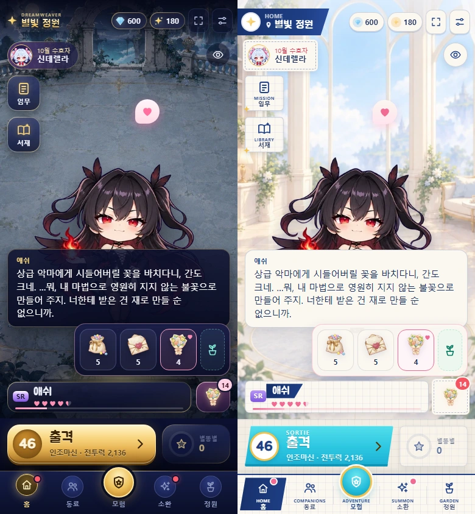
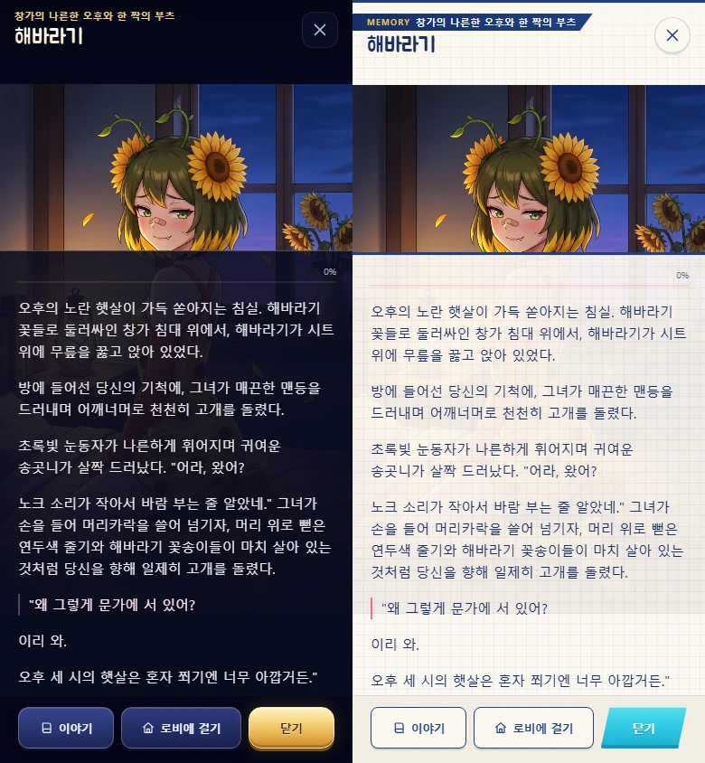
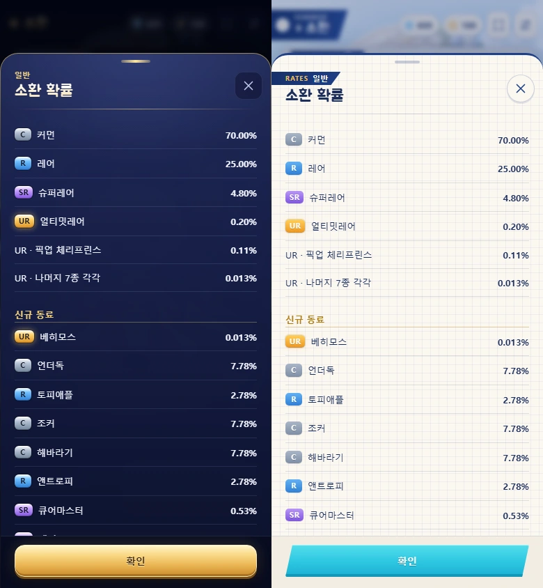

# 감속·가격·소환·대사 후속 수정 검수 (2026-10-25)

Chromium 390×844, 정식 어두운판과 Bright다. [측정 JSON](validation.json)에 긴 선호 선물 대사, 정규 베히모스/시즌 일반 UR8종 안내, 가장 긴 본문(언더독)과 가장 긴 제목(해바라기)의 메모리얼·끝까지 읽기 저장을 기록했다. 8개 시나리오, 페이지 오류0·외부 요청0·가로 넘침0·이미지 실패0이다. 실제 유료 API 응답은 요청하지 않았고, 요청 프롬프트는 별도 fetch 모의 검사로 확인했다.

