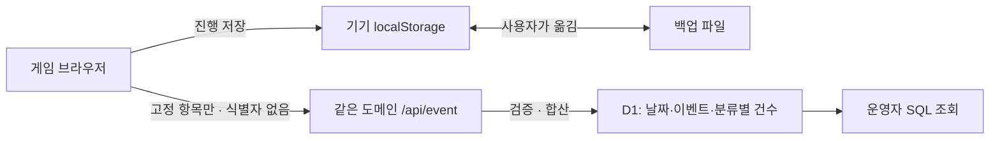

# 공개 웹 릴리스

PR #697이 합쳐진 `b413f9a`의 공개판을 웹에 공개하기 위한 배포 경로다. 전투·밸런스·주기·보상·그림과 기존 저장 형식은 유지한다. 이 변경은 **배포 준비**이며 계정 생성, D1 생성, 공개 업로드와 실제 사용자 수집은 수행하지 않는다. PR 병합도 배포를 실행하지 않는다.

## 범위

| 작업 | 최종 방식 | 제외한 작업 |
|---|---|---|
| 페이지 소스의 개발 흔적 | 작은 HTML + 압축된 해시 이름 JS/CSS + 외부 미디어, 주석·소스맵·테스트 전역/지급 도구 제거 | 강한 난독화, 디버거 방해, 서버 전투 연산 |
| 저장 | 기존 localStorage + 백업 내보내기/복원 | 로그인, ID만 입력하는 클라우드 저장, 서버 세이브 |
| 플레이 통계 | 같은 도메인 Worker → D1 날짜별 합계 | PostHog/외부 분석 SDK, 개인·기기·세션 ID, 개인별 이력·재방문율 |
| 접근/보안 | HTTPS, CSP, 허용 목록 배포, 요청 검증·상한 | 공유 비밀번호 입장권, 계정, 랭킹/재화의 서버 검증 |
| 모바일 | Chromium/WebKit의 실제 HTTP 번들, 좁은 세로·가로 화면 검사 | PWA 설치·서비스 워커, 실제 기기 성능 인증 |



웹 브라우저가 실행하는 JS는 다운로드·포맷 정리·분석할 수 있다. 이번 패키징은 ‘페이지 소스 보기’에서 원본 주석·파일 구조·개발용 도구가 그대로 드러나는 문제를 줄인다. 소스 비공개 보장이나 변조 방지 DRM은 아니다. **현재 GitHub 저장소는 공개**이므로 소스와 Git 이력은 그곳에서 여전히 볼 수 있다. 공개 빌드로 저장소 공개 범위를 바꾸지는 않는다.

## 빌드와 검증

저장소 루트에서 Node 22 이상과 잠금 파일의 의존성을 사용한다. 기본 빌드는 수집 비활성이다.

```powershell
npm ci
npm run build:defense-public:web
npm run check:defense-public:web
npm run serve:defense-public:web
```

`http://127.0.0.1:4180/`는 밤, `/bright.html`은 맑음 테마다. 단순 미리보기 서버는 `/api/event`를 수집하지 않는다. 출력은 `defense_public/dist-public/`이고 Git에 넣지 않는다. **이 디렉터리만 정적 에셋으로 업로드**한다. 저장소 루트, `src/`, `dist/`, `dist-test/`, 테스트 결과, 백업 파일을 업로드하지 않는다.

파일은 내용 해시 이름을 쓰며 이미지·음악을 재압축하지 않는다. HTML은 약 9KB, 전체 두 테마 묶음은 약 23.1MiB다. 소스맵, 개발 표시, 비허용 파일, 깨진 참조, 해시 불일치, 호스팅 파일 크기 한도를 검사한다. `_headers`는 CSP 및 캐시 정책이다. 실행 스크립트는 같은 출처만 허용하고, 기존 동적 레이아웃 때문에 인라인 **스타일**은 허용한다. JavaScript의 인라인 실행은 허용하지 않는다. 이 검사와 콘텐츠 해시는 공급망 공격의 전자서명 검증을 대신하지 않는다.

입력이 바뀌어 예전 파일이 섞이면 빌더는 삭제하지 않고 중단한다. 기존 출력은 롤백용으로 별도 보관한 뒤 새 출력 경로를 사용한다.

```powershell
node defense_public/scripts/build.mjs --public-web --outdir defense_public/test-results/release-candidate
node defense_public/scripts/check-public.mjs defense_public/test-results/release-candidate
```

같은 입력의 재빌드는 같은 내용 해시를 만든다. `--unlocked`, `--preview`, `--solo` 등의 플래그와 공개 웹 빌드의 혼합은 거부한다. 기존 `npm run build:defense-public`은 계속 두 단일 HTML을 만들며, 로컬 배포용 산출물 두 개는 기존 규칙대로 커밋한다. 웹 산출물과는 별도다.

```powershell
npm run test:defense-public
npm run test:defense-public:web
npm ci --prefix defense_public/deploy/cloudflare
node defense_public/tests/collector-smoke.mjs
npm run check --prefix defense_public/deploy/cloudflare
```

마지막 명령은 `wrangler deploy --dry-run`으로 실제 배포하지 않는다. 수집기 검사는 임시 로컬 D1과 workerd만 사용한다. 모바일 검사는 공개 JS에 `STAR_GARDEN` 같은 테스트 전역을 넣지 않고 화면 조작과 저장 파일로 확인한다. CI의 기존 `Defense release gate`에서 관련 변경만 골라 같은 검사와 두 브라우저를 실행한다. 화면 결과는 `defense_public/test-results/public-web/` 및 CI의 `defense-public-web-review` 아티팩트에 남는다.

## 최소 플레이 통계

외부 SDK, 분석 호스트, 토큰을 받는 설정은 없다. 네트워크 목적지는 같은 출처의 `/api/event` 하나다. 브라우저는 쿠키·referrer 없이 전송하며 리다이렉트를 따라가지 않는다. 분석 때문에 localStorage, IndexedDB, 쿠키나 지속 전송 대기열을 만들지 않는다. 동의 팝업/설정 스위치는 없으며 설정 화면에 수집 항목을 안내한다. 운영자가 수집을 켜면 자동으로 전송한다.

| 이벤트 | 전송 가능한 항목 | 알 수 있는 것 |
|---|---|---|
| `game_boot` | 없음 | 페이지 로드 건수 |
| `screen_view` | 고정 화면명 | 화면 전환 건수 |
| `tutorial_step` | 고정 안내 단계, 표시/완료/건너뜀 | 안내 단계별 발생 건수 |
| `battle_start` | 모드, 단계, 난이도, 신규/이어하기, 자동 여부 | 전투 시작/재개 건수 |
| `battle_end` | 모드, 단계, 난이도, 승/패/포기, 웨이브 구간, 소요 시간 구간, 자동 여부 | 난이도·실패 구간·전투 길이 분포 |
| `progress` | 현재 화면, 완료 단계 | 해당 진행도에서 관측된 횟수 |
| `backup_action` | 내보내기/복원, 성공/실패 | 백업 조작 결과 건수 |
| `game_error` | 저장 불가/이미지 로딩 실패/일반 오류 코드 | 오류 종류별 건수 |

초 단위 시간이 아닌 `<1분 / 1~5분 / 5~15분 / 15~60분 / 60분 이상` 구간을 보낸다. 웨이브는 `0 / 1~3 / 4~6 / 7~9 / 10 이상`이다. `progress`는 보이는 동안 60초마다, 숨김 전환 때 기록한다. 안내 표시는 페이지 안에서 단계별 중복을 줄인다. 백업 내보내기 성공은 다운로드 시작을 뜻하며, 파일을 사용자가 실제 보관했는지는 알 수 없다.

**보내거나 저장하지 않는 것:** 사용자·기기·세션 식별자, 저장 토큰, 정확한 시각, 자유 입력, 전체 URL/쿼리, 이메일, IP, User-Agent, 스택/오류 메시지, 세이브 원문, 캐릭터 구성, 화면 녹화. 허용되지 않은 필드를 하나라도 포함한 요청은 전체 거부한다. 분석 전송 함수는 게임의 저장 객체를 받지 않는다.

서버가 UTC 날짜를 붙이고 `(날짜, 이벤트, 검증된 분류 조합)`의 합계를 증가시킨다. 요청 원문이나 이벤트 한 건당 행은 보관하지 않는다. 별도 예산 테이블도 날짜당 합계·입장 플래그뿐이다. 여러 요청의 합산과 한도 처리는 원자적 D1 트랜잭션으로 묶는다. 일별 데이터는 30개 UTC 날짜까지 유지하며 매일 예약 삭제한다. 조회용 공개 API는 없다. 운영자는 `deploy/cloudflare/report.sql`을 인증된 D1 관리 경로에서 실행한다.

`game_boot`는 사람 수가 아니다. 동일인이 재시도하면 여러 건이다. 탭 종료/네트워크 단절 시 전송이 누락될 수 있고 저장 후 나가기는 패배나 포기가 아니다. **시작 건수와 종료 건수의 차이를 정확한 이탈률로 표시하지 않는다.** 종료 승패·포기 비율, 실패 웨이브·소요 구간, 안내 완료 건수의 큰 차이를 개선의 단서로 사용한다. 개인별 순서, 고유 인원, 복귀/다음 날 유지율, 사람 단위 퍼널은 계산하지 않는다.

개인을 알아볼 수 없는 정보의 법적 적용 제외는 [개인정보 보호법 제58조의2](https://law.go.kr/lsLinkCommonInfo.do?lsJoLnkSeq=1022694479)의 기준이다. ID 필드가 없다는 사실만으로 모든 처리 단계의 법적 성격을 단정하지 않는다. **Cloudflare는 통신 전달과 인프라 보호 과정에서 접속 IP를 처리할 수 있다.** 애플리케이션은 IP를 읽거나 DB에 저장하지 않으며 Workers Observability/요청 로그를 설정에서 끈다. 공개 전에 계정의 Logpush, Web Analytics, 추가 분석 스크립트 등 별도 수집 설정이 켜져 있지 않은지 확인한다. 분석 SDK나 식별자를 나중에 추가하면 이 문서의 설계와 범위도 다시 검토해야 한다.

## 요청 제한과 무료 테스트

- 요청은 POST JSON, 정확히 같은 Origin, 쿼리 없음, 최대 8KB/8이벤트다. 다른 사이트의 브라우저 요청을 차단하지만 Origin은 일반 HTTP 클라이언트가 위조할 수 있으므로 인증 수단은 아니다.
- 페이지 메모리 대기열 24건, 한 페이지 최대 400건/64KB, 10초마다 최대 8건 전송한다. 5초 타임아웃 후 폐기하며 재시도/디스크 보관을 하지 않는다.
- IP를 쓰지 않는 공통 경로 키로 Cloudflare 위치당 대략 120요청/분을 제한하고 DB에서는 전체 하루 10,000이벤트를 제한한다. 초과 요청은 429, DB 장애는 503이며 게임은 계속된다.
- 계정 없는 공개 API의 통계 조작, 악성 요청에 의한 한도 소진, 서비스 거부를 완전히 막을 수는 없다. 개인 게임 저장·재화도 클라이언트에서 변조할 수 있다. 통계는 보상 지급이나 순위의 신뢰 근거로 쓰지 않는다.

Cloudflare Workers **Static Assets + Worker + D1** 하나로 준비했다. Pages와 Worker를 별도로 연결하는 운영 단계를 줄인다. 정적 요청은 Assets가 처리하고 `/api/*`만 Worker를 먼저 실행한다. 현재 Free 한도는 동적 Worker 100,000요청/일, D1 읽기 500만 행/일·쓰기 100,000행/일이며 정적 요청은 무료다. 이 한도는 악성 요청이나 설정 변경에도 비용이 절대 발생하지 않는다는 보장은 아니다. 무료 계정으로 시작하고 유료 전환 전에 사용량을 확인한다. [Static Assets 요금](https://developers.cloudflare.com/workers/static-assets/billing-and-limitations/), [Workers 한도](https://developers.cloudflare.com/workers/platform/limits/), [D1 요금](https://developers.cloudflare.com/d1/platform/pricing/), [Rate Limit 특성](https://developers.cloudflare.com/workers/runtime-apis/bindings/rate-limit/)

## 실제 배포할 때

이 절차의 `create`, `--remote`, 마지막 `deploy`는 아직 수행하지 않았다. 기본 설정의 D1 ID는 자리표시자다. Cloudflare 계정 연결과 최종 호스트 선택은 운영자가 배포 시 한다.

1. 최종 저장소 커밋과 CI 통과를 확인한다. 아래 기기 점검을 마치고 최종 호스트를 정한다. `workers.dev`로 무료 테스트할 수 있다. 나중에 커스텀 도메인으로 바꾸면 저장 출처도 바뀐다.
2. 루트에서 `release.example.json`을 `release.local.json`으로 복사한다. 이 예시는 집계 수집 활성이다. 분석 없이 공개하려면 `enabled`를 false로 두고 Worker도 false로 맞춘다.

```powershell
Copy-Item defense_public/release.example.json defense_public/release.local.json
$env:GARDEN_RELEASE_CONFIG = 'defense_public/release.local.json'
node defense_public/scripts/build.mjs --public-web --outdir defense_public/test-results/release-candidate
node defense_public/scripts/check-public.mjs defense_public/test-results/release-candidate
```

3. `deploy/cloudflare/wrangler.jsonc`에서 `name`을 선택하고 `assets.directory`를 방금 출력한 폴더(설정 파일 기준 `../../test-results/release-candidate`)로 바꾼다. `vars.ANALYTICS_ENABLED`는 클라이언트와 일치하도록 문자열 `"true"`로 맞춘다. 기본 `false`이면 수신하더라도 저장하지 않는다.
4. 별도 터미널에서 아래를 진행한다. 로그인은 **배포 운영자용**이며 플레이어 로그인이 아니다.

```powershell
cd defense_public/deploy/cloudflare
npm ci
npx wrangler login
npx wrangler d1 create star-garden-counts
```

5. 생성 결과의 `database_id`를 설정의 자리표시자에 넣는다. 이후 명령은 실제 원격 DB를 변경한다.

```powershell
npx wrangler d1 migrations apply DB --remote
npm run check
npx wrangler deploy
```

6. 배포 URL에서 밤/맑음, 저장/새로고침/이어하기, 백업 복원, 404, CSP와 캐시 헤더를 확인한다. 이벤트의 응답이 204인지, D1에 합계만 생기는지 점검한다. `observability.enabled:false`, 소스맵 업로드 없음, 별도 분석 기능 없음도 유지한다. [정적 헤더 동작](https://developers.cloudflare.com/workers/static-assets/headers/)

```powershell
npx wrangler d1 execute DB --remote --file report.sql
```

새 버전은 새 출력 폴더로 빌드해 같은 Worker/호스트에 배포한다. `build-manifest.json`의 buildId와 배포 버전, 산출물을 운영자가 보관한다. HTML은 재검증하고 해시 에셋만 장기 캐시한다. 롤백은 Cloudflare의 이전 배포 또는 보관한 전체 산출물과 Worker 설정을 같이 사용한다. 저장 형식이 바뀌는 미래 버전의 롤백은 별도 호환성 점검이 필요하다. 수집 중지는 `ANALYTICS_ENABLED:"false"` 적용 후 배포하며, 클라이언트도 비활성으로 재빌드하면 전송 자체가 멈춘다.

## 저장과 공개 전 남은 점검

저장 키는 계속 `astra.star-garden.public.v1`이다. **동일한 브라우저·동일한 출처(프로토콜/호스트/포트)** 안에서만 이어진다. 밤/맑음은 같은 출처면 공유한다. 기존 로컬 HTML, localhost, 미리보기 URL, 최종 도메인 사이에는 자동 이전되지 않는다. 먼저 설정 → 백업 저장, 새 주소에서 백업 불러오기를 사용한다. 사이트 데이터 삭제·시크릿 모드 종료·브라우저 제거로 진행이 사라질 수 있다. 닉네임만으로 서버 저장을 찾게 하면 타인의 저장에 접근할 수 있어 도입하지 않았다.

실제 iPhone Safari와 Android Chrome에서 다음을 확인하고 공개 여부를 결정한다. 데스크톱 WebKit은 iPhone 실기기가 아니다.

- 주소 표시줄 펼침/접힘, 노치·안전 영역, 회전, 가상 키보드 상황에서 버튼/시트가 가려지지 않는지
- 손가락 드래그 합성, 필살기 길게 누르기, 자동/일시정지, 화면 잠금 후 복귀
- 최초 터치 후 음악 재생, 기기 음소거/절전 상황
- 파일 다운로드·선택으로 백업 왕복, 재접속 저장 유지, 저장 불가 시 안내
- 느린 모바일 회선에서 초기 로딩·이미지 대체, 네트워크 끊김 중 플레이·저장, 프레임 저하·발열

공개 URL에서의 검증과 위 실기기 점검은 이 PR의 로컬 자동 검사 결과에 포함하지 않는다.
