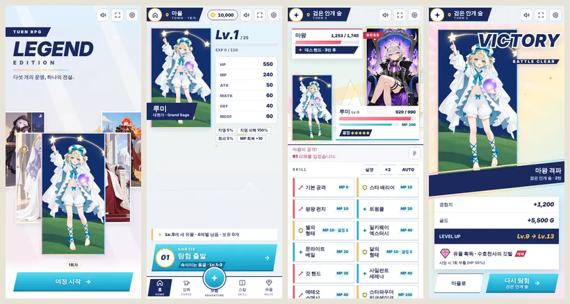
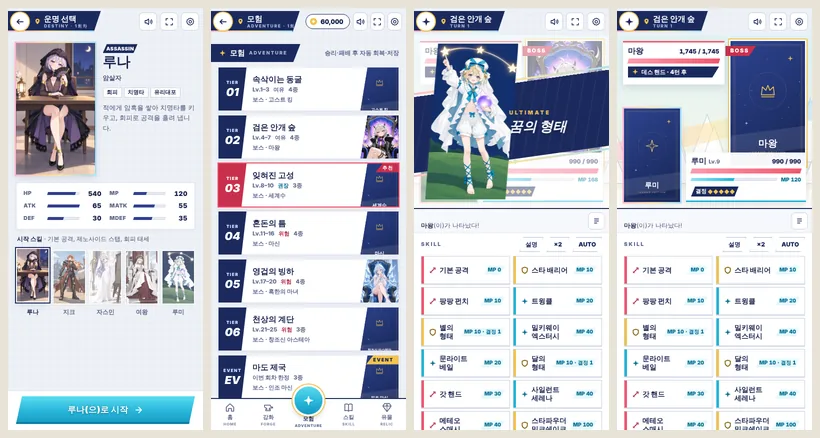

# Turn RPG: Legend Edition

턴제 RPG 단일 페이지입니다. **`new.html` 하나에 화면·규칙·데이터·그림·음악이 모두 들어 있습니다.** 빌드와 테스트 스크립트는 없습니다.

- 브라우저에서 `new.html`을 직접 엽니다. 인터넷 연결이나 다른 파일이 필요 없습니다.
- 캐릭터와 적의 그림은 카드 게임과 같은 3:5 일러스트입니다. 같은 폴더에 두면 바로 씁니다.
  - 캐릭터: `luna.png`를 먼저 찾고, 없으면 카드 게임의 이름인 `루나.png`를 찾습니다.
  - 적: `<적 이름>.png`(예: `혹한의 마녀.png`).
  - 그림이 없으면 카드 게임처럼 이름을 얹은 카드 뒷면(남색·금색)을 보여줍니다.

미리보기의 일러스트는 별빛 정원(`defense/`)의 기념 일러스트를 3:5로 잘라 임시로 넣은 것입니다. 실제 게임은 플레이어의 PNG를 씁니다.

## 한 판의 흐름

타이틀 → 운명(캐릭터) 선택 → 마을에서 던전 선택 → 무작위 적 1명과 턴제 전투 → 결과 → **다시 탐험** 또는 마을로. 창조신 아스테아를 쓰러뜨리면 마을에서 다음 회차(적 +10%, 최대 레벨 +1)로 넘어갑니다.

## 2026-10 전면 개편

**화면**
- 모든 그림 틀은 3:5입니다. 레이아웃은 일러스트를 중심으로 짰습니다.
  - 타이틀: 다섯 캐릭터를 부채꼴로 겹쳐 세운 키 비주얼. 마지막으로 플레이한 캐릭터가 앞에 섭니다.
  - 마을 홈: 내 캐릭터 일러스트와 출격 버튼.
  - 모험 목록: 던전마다 보스 일러스트를 썸네일로 보여줍니다.
  - 전투: 적 카드는 오른쪽 위, 내 카드는 왼쪽 아래, 정보판은 각각 맞은편에 둔 대각 구도입니다.
- 색은 스텔라 소라식입니다.
  - 남색 위치 띠(흰 원 버튼 + 핀 + 제목), 아쿠아 행동 버튼, 금색 보상, 코랄 위험.
  - 분홍·레몬·하늘 세 파스텔은 면을 칠하지 않고 테두리의 빛(엣지)으로 씁니다: 띠의 밑줄, 일러스트 테두리, 필살기 버튼.
  - 승리·유물 획득·필살기 컷인처럼 중요한 순간에만 화면 전체로 번집니다.
- 전투 연출
  - 한 턴을 계산한 뒤 기록을 순서대로 재생합니다. 큰 피해 숫자(치명타는 CRITICAL), 카드 흔들림, HP 잔상이 나옵니다.
  - 필살기·보스 등장·보스 특수기는 일러스트가 대각선 띠로 들어오는 컷인으로 보여줍니다. 화면을 누르면 건너뜁니다.
  - 적의 다음 행동을 예고합니다: 데스 핸드까지 남은 턴, 차지, 반격 태세, 마신의 면역 턴, 시간의 지배자 예고, 세계수의 빛 등. 예고가 없는 적은 쓰는 기술의 종류와 위력을 보여줍니다.
  - 장미·꿈의 결정·앱솔루트·디바인·암흑 같은 캐릭터 자원이 늘 보입니다.
- **AUTO · ×2 · 반복 탐험**
  - AUTO는 다음 순서로 스킬을 고릅니다.
    1. 이번 공격으로 끝낼 수 있으면 마무리
    2. 모아 둔 차지 발동
    3. 이번 턴 큰 공격이 예고되면 맞는 방어(물리 무효·마법 무효·완전 회피·가드·언다잉)
    4. HP가 낮으면 회복
    5. 꺼진 강화
    6. 위험을 감안한 기대 피해가 가장 큰 공격
  - 적정 레벨 던전에서 무작위 선택·기본 공격만 쓰기보다 승률이 같거나 높고, 전투가 짧습니다.
  - AUTO를 켠 채 이기면 3초 뒤 같은 던전을 다시 탐험합니다.
- 버튼
  - MP·결정이 부족한 스킬, 골드가 부족한 구매는 이유를 붙여 비활성화합니다.
  - 행동 불가 턴에는 "턴 넘기기" 하나만 나옵니다.
  - 키보드로는 1~9가 스킬, Space가 재생 건너뛰기입니다.
- 소리·화면: 마을·전투·보스 음악과 효과음은 WebAudio로 만들고 첫 터치 뒤부터 납니다. 전체화면 버튼은 브라우저가 지원할 때만 보입니다.

**참고한 게임과 가져온 것**
- 스텔라 소라: 남색 위치 띠, 아쿠아 주 행동, 금색 반짝이, 대각선 이름 띠, 무지개 파스텔의 획득 화면.
- 블루 아카이브·붕괴: 스타레일: 필살기 컷인, 크고 굵은 피해 숫자.
- 슬레이 더 스파이어·씨 오브 스타즈: 적의 다음 행동을 미리 보여주는 예고.
- 포켓몬 전투 구도: 적은 오른쪽 위, 나는 왼쪽 아래, 정보판은 맞은편.
- 모바일 수집형 RPG 공통: 홈의 캐릭터 일러스트와 출격 버튼, 가운데 원형 모험 버튼이 있는 하단 탭, AUTO·×2·반복 전투.

**흐름**
- 전투가 끝나 마을로 돌아오면 HP·MP가 자동으로 모두 회복됩니다. 예전처럼 매 판 상점에서 50G를 내고 회복할 필요가 없습니다.
- 마을에 돌아올 때와 구매·강화 직후 자동 저장합니다. 수동 저장 버튼은 없앴습니다.
- 결과 창에서 같은 던전을 바로 다시 탐험할 수 있습니다. 전투 중에는 설정에서 후퇴할 수 있습니다(패배와 같고 잃는 것은 없음).
- 타이틀의 "새 여정"은 회차·클리어 기록·보스 유물 해금을 지우지 않습니다. 모든 기록 삭제는 설정의 "완전 초기화"에서만 합니다.

**규칙 수정** (설명과 다르게 동작하던 곳)
- 남는 경험치는 다음 레벨로 이어집니다. 한 번에 여러 레벨이 올라도 유물 레벨(5·10·15·20·25·30)을 빠뜨리지 않습니다. 예전에는 전투당 1레벨만 오르고 남는 경험치는 버려졌습니다.
- 반사·가시·장미 피해로 적이 쓰러지면 바로 승리합니다(예전에는 한 턴 늦었습니다). 혹한의 마녀·골드 드래곤의 부활과 히든 보스 교대도 피해의 출처와 상관없이 같은 규칙을 따릅니다.
- 카니지·선파이어의 HP 소모, 반격, 여신의 절대 피해로 쓰러질 때도 언다잉과 수호천사의 깃털이 작동합니다.
- 루미가 MP가 모자랄 때 형태 변환을 누르면 꿈의 결정만 사라지던 문제를 고쳤습니다.
- 마나 강화의 첫 구매는 회복량이 그대로라 효과가 없었습니다. 3단계(2,000 / 3,000 / 4,000 G)로 정리했고, 단계마다 회복량이 오릅니다. 예전 저장의 단계는 그대로 이어집니다.
- 황금 주머니(골드 +20%)와 용의 비늘(체력·방어·마방 +50%)은 효과가 없었습니다. 이제 설명대로 작동합니다. 신기 에스티아는 설명(+50%)보다 큰 +100%가 적용되던 것을 설명에 맞췄습니다.
- 무모한 돌진의 치명 피해가 두 번 더해지던 것을 설명대로 +80%만 적용합니다. 다크 메테오는 설명대로 암흑을 부여합니다.
- 여신 강림은 회복과 강화만 하고, 의미 없던 "적에게 1 피해"가 더 이상 나오지 않습니다.
- 히든 보스(아이리스)를 쓰러뜨리면 데이터에만 있고 얻을 방법이 없던 "전설의 증표"(모든 능력치 +100%)가 해금됩니다.
- 완전 초기화가 이벤트 던전 사용 기록을 남겨 두던 문제를 고쳤습니다.
- 처음 열 때 저장이 없으면 확인 창 하나로 회차·해금 기록까지 지우던 동작을 없앴습니다.
- 행동 불가 턴에도 적의 기절이 적용됩니다.

## 저장

저장 키는 예전과 같습니다(`turnRpgSaveData`, `turnRpgCycle`, `turnRpgClears`, `turnRpgBossDrops`, `turnRpgUsedEvents`). 예전 버전의 저장도 그대로 불러옵니다. 스킬 정의는 저장본이 아니라 현재 데이터에서 읽습니다. 소리 설정만 새 키 `turnRpgSound`에 저장합니다.

## 확인한 것과 확인하지 못한 것

Chromium(390×844·360×640)에서 다음을 확인했습니다.
- 다섯 캐릭터 × 모든 던전(이벤트·히든 포함) 무작위·AUTO 전투 1,080회: 예외, NaN, 승패 오판정이 없었고, AUTO는 늘 쓸 수 있는 스킬을 골랐습니다.
- 예전 형식 저장 불러오기.
- 패배 후 회복·자동 저장, 골드 부족 시 버튼 비활성화.
- 창조신 클리어 → 다음 회차, 히든 보스 교대.
- AUTO 승리 → 3초 뒤 자동 재탐험, 후퇴.
- 그림이 있을 때와 없을 때의 화면.
- 글자 대비: 아쿠아 버튼 위의 굵은 흰 글자(별빛 정원 Bright와 같은 처리) 외에는 문제가 없었습니다.

실제 휴대폰과 Safari(WebKit), 플레이어의 실제 일러스트(미리보기는 대체 그림), 실제 스피커로 듣는 음악, 오래 플레이할 때의 밸런스 체감은 확인하지 못했습니다.
